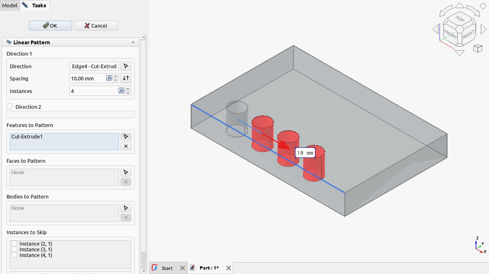

<!-- Generated by docs/build.py from docs/_data/catalog.json, docs/_authored/tools/linear-pattern.md, docs/_data/panels.json. Do not edit this file: change its sources and run `pixi run docs`. -->

# Linear Pattern

{ .tool-icon }
Repeats features or bodies in one or two directions.
{ .tool-lead }

Linear Pattern repeats features or bodies in a row, or in a grid with a second direction: rows of holes, slots, ribs.

## How to use it

1. Select the features to repeat (in the tree, or a face they made).
2. Click **Linear Pattern**.
3. Click an edge, axis or plane for **Direction 1**, and set the **Spacing** and number of **Instances** (the original counts as one). Drag the arrow to change the spacing.
4. Tick **Direction 2** for a grid.
5. Click **OK**.

## Good to know

- **Instances to Skip** leaves gaps: tick them in the list, or click **Pick Instances in the View** and click them.
- **Faces to Pattern** repeats faces when there is no feature to pick; **Bodies to Pattern** repeats whole bodies.

## Where to find it

- The **Features** toolbar, in the **Patterns** drop-down.
- **Solid Design** → **Patterns** → **Linear Pattern**
- **Insert** → **Pattern/Mirror** → **Linear Pattern**
- Command search: press <kbd>/</kbd> in the 3D view and type its name.
- The command line: <kbd>:</kbd> then `linearpattern` ([below](#on-the-command-line)).

## The panel

Every control's tooltip says the same as here: hover over it in FreeCAD. **OK** (or <kbd>Enter</kbd>) makes the feature, **Cancel** (or <kbd>Esc</kbd>) leaves the model as it was.

### Direction 1

| Control | Kind | What it does |
| :-- | :-- | :-- |
| **Direction** | Selection box: click an edge or plane | The direction of the pattern: a straight edge, an axis, or a plane (along its normal) |
| **Spacing** | A length | Distance between instances *(a flip button beside it)* |
| **Instances** | A count | How many, counting the original |

### Direction 2

Pattern in a second direction too

*Optional: tick its title to use it.*

| Control | Kind | What it does |
| :-- | :-- | :-- |
| **Direction** | Selection box: click an edge or plane | The second direction of the pattern *(shown for some choices only)* |
| **Spacing** | A length | Distance between instances in the second direction *(a flip button beside it; shown for some choices only)* |
| **Instances** | A count | How many in the second direction, counting the original *(shown for some choices only)* |
| **Pattern seed only** | A check box | Repeat only the original in the second direction, not the whole first row *(shown for some choices only)* |

### Features to Pattern

| Control | Kind | What it does |
| :-- | :-- | :-- |
| **Features** | Selection list: click features in the tree, or their faces | The features to repeat: click them in the tree, or click a face they made |

### Faces to Pattern

| Control | Kind | What it does |
| :-- | :-- | :-- |
| **Faces** | Selection list: click faces | Every face of a boss, hole or pocket to repeat (its walls and top or floor). Material is added where they bound material, cut where they bound a gap. |

### Bodies to Pattern

| Control | Kind | What it does |
| :-- | :-- | :-- |
| **Bodies** | Selection list: click bodies in the 3D view or tree | Whole bodies to repeat |

### Instances to Skip

Tick the instances to leave out

| Control | Kind | What it does |
| :-- | :-- | :-- |
|  | A list | Every instance but the original: tick one to leave it out |
| **Pick Instances in the View** | A button | While on, clicking the model where an instance is (or would be) leaves it out, or puts it back |

## Drag handles

While the panel is open, drag the handles in the 3D view to set **Spacing**, or click a handle's value and type. The same handles show when you select the feature in the tree, so you can change it without opening the panel. See [drag handles](../../guides/drag-handles.md).

## On the command line

Press <kbd>:</kbd> in the 3D view and type `linearpattern`, then what to set. See [the command line](../../guides/keyboard.md) for how it works.

Values typed straight after the name set, in order: **Spacing**, **Instances**. For example `:linearpattern 10 2`.

??? note "Options it takes"

    | Option | How to type it | What it is |
    | :-- | :-- | :-- |
    | `Reverse` | `reverse` turns it on, `reverse=no` off | Reverse direction |
    | `Spacing` | `spacing=`a value | Spacing |
    | `Instances` | `instances=`a whole number | Number of instances (with the seed) |
    | `Direction2` | `direction2` turns it on, `direction2=no` off | Pattern in a second direction |
    | `PatternSeedOnly` | `patternseedonly` turns it on, `patternseedonly=no` off | Repeat only the seed in Direction 2 |
    | `Reverse2` | `reverse2` turns it on, `reverse2=no` off | Reverse direction |
    | `Spacing2` | `spacing2=`a value | Spacing |
    | `Instances2` | `instances2=`a whole number | Number of instances (with the seed) |

## Properties

??? info "All properties"

    What the feature stores, as the **Property** editor shows it (select the feature in the tree, then the **Data** tab). The panel sets these for you.

    | Property | Kind | Default | What it is |
    | :-- | :-- | :-- | :-- |
    | `Features` | Objects | – | Features to repeat |
    | `Bodies` | List | – | Bodies to repeat, by ID |
    | `Faces` | Picks | – | Faces to repeat: every face of a boss, hole or pocket |
    | `Direction1Ref` | Picks | – | Edge, axis, or plane (its normal) |
    | `Reverse` | Yes/No | No | Reverse direction |
    | `Spacing` | Length | 10 mm | Spacing |
    | `Instances` | Whole number | 2 | Number of instances (with the seed) |
    | `Direction2` | Yes/No | No | Pattern in a second direction |
    | `PatternSeedOnly` | Yes/No | No | Repeat only the seed in Direction 2 |
    | `Direction2Ref` | Picks | – | Edge, axis, or plane (its normal) |
    | `Reverse2` | Yes/No | No | Reverse direction |
    | `Spacing2` | Length | 10 mm | Spacing |
    | `Instances2` | Whole number | 2 | Number of instances (with the seed) |
    | `InstancesToSkip` | List | – | Instances left out, as i,j (the seed is 1,1) |

