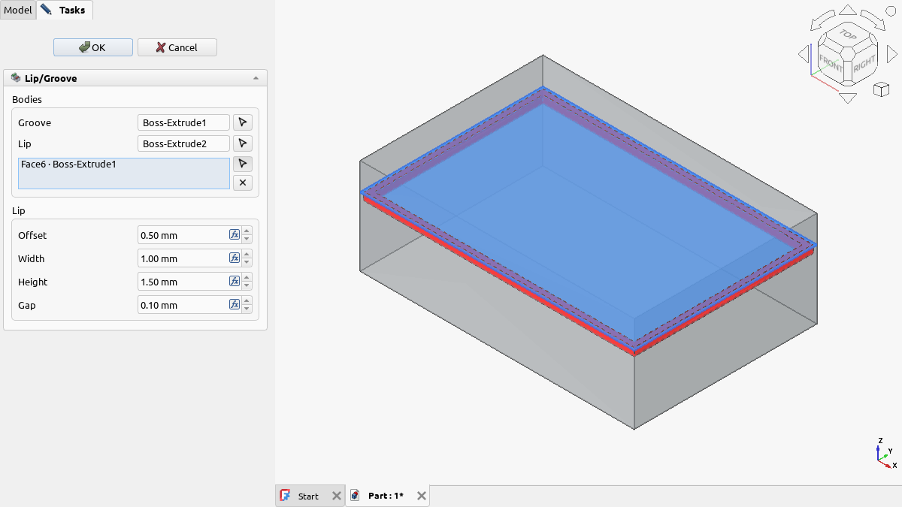

<!-- Generated by docs/build.py from docs/_data/catalog.json, docs/_authored/tools/lip-groove.md, docs/_data/panels.json. Do not edit this file: change its sources and run `pixi run docs`. -->

# Lip/Groove

{ .tool-icon }
Where two bodies meet on a flat face, grows a lip out of one and cuts a matching groove in the other.
{ .tool-lead }

Lip/Groove makes the lip and groove where two shells meet, so they locate and seal: the lip grows out of one body, a matching groove is cut into the other.

## How to use it

1. Model the two bodies meeting on a flat face (for example, split a shelled box into a base and a lid with [Split](split.md)).
2. Select both bodies and click **Lip/Groove**. The first is the **Groove** body, the second the **Lip** body.
3. Click the flat face of the lip body where they meet.
4. Set the lip's **Offset** from the outside, **Width**, **Height** and the **Gap** between lip and groove.
5. Click **OK**.

## Where to find it

- The **Features** toolbar, in the **Fastening Features** drop-down.
- **Solid Design** → **Features** → **Lip/Groove**
- Command search: press <kbd>/</kbd> in the 3D view and type its name.
- The command line: <kbd>:</kbd> then `lipgroove` ([below](#on-the-command-line)).

## The panel

Every control's tooltip says the same as here: hover over it in FreeCAD. **OK** (or <kbd>Enter</kbd>) makes the feature, **Cancel** (or <kbd>Esc</kbd>) leaves the model as it was.

### Bodies

| Control | Kind | What it does |
| :-- | :-- | :-- |
| **Groove** | Selection box: click a body | The body the groove is cut into |
| **Lip** | Selection box: click a body | The body the lip grows from |
| **Faces** | Selection list: click the mating face | The lip body's flat face where the two bodies meet |

### Lip

| Control | Kind | What it does |
| :-- | :-- | :-- |
| **Offset** | A length | The lip's distance in from the face's outer edge |
| **Width** | A length | Lip width |
| **Height** | A length | Lip height |
| **Gap** | A length | Clearance round the lip, in the groove |

## On the command line

Press <kbd>:</kbd> in the 3D view and type `lipgroove`, then what to set. See [the command line](../../guides/keyboard.md) for how it works.

??? note "Options it takes"

    | Option | How to type it | What it is |
    | :-- | :-- | :-- |
    | `LipOffset` | `lipoffset=`a value | The lip's distance in from the face's outer edge |
    | `LipWidth` | `lipwidth=`a value | Lip width |
    | `LipHeight` | `lipheight=`a value | Lip height |
    | `Gap` | `gap=`a value | Clearance round the lip, in the groove |

## Properties

??? info "All properties"

    What the feature stores, as the **Property** editor shows it (select the feature in the tree, then the **Data** tab). The panel sets these for you.

    | Property | Kind | Default | What it is |
    | :-- | :-- | :-- | :-- |
    | `GrooveBody` | Text |  | The body the groove is cut into |
    | `LipBody` | Text |  | The body the lip grows from |
    | `Items` | Picks | – | The lip body's flat face where the two bodies meet |
    | `LipOffset` | Length | 0.5 mm | The lip's distance in from the face's outer edge |
    | `LipWidth` | Length | 1 mm | Lip width |
    | `LipHeight` | Length | 1.5 mm | Lip height |
    | `Gap` | Length | 0.1 mm | Clearance round the lip, in the groove |

