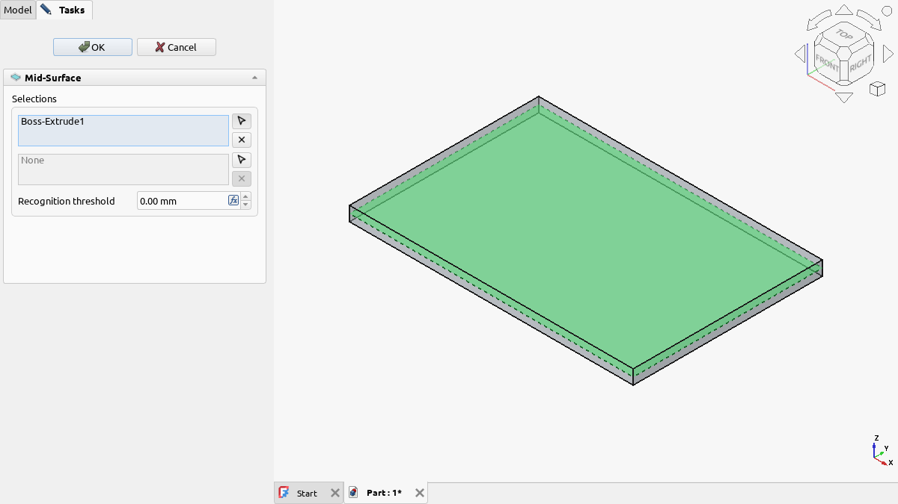

<!-- Generated by docs/build.py from docs/_data/catalog.json, docs/_authored/tools/mid-surface.md, docs/_data/panels.json. Do not edit this file: change its sources and run `pixi run docs`. -->

# Mid-Surface

{ .tool-icon }
Surfaces midway between the two sides of thin walls.
{ .tool-lead }

Mid-Surface makes surfaces midway between the two sides of thin walls: for analysis, or to rebuild a shape with another thickness.

## How to use it

1. Select the body (or pairs of faces) and click **Mid-Surface**.
2. Click **OK**.

## Where to find it

- The **Surfaces** toolbar, in the **More Surfaces** drop-down.
- **Solid Design** → **Surfaces** → **Mid-Surface**
- **Insert** → **Surface** → **Mid-Surface**
- Command search: press <kbd>/</kbd> in the 3D view and type its name.
- The command line: <kbd>:</kbd> then `midsurface` ([below](#on-the-command-line)).

## The panel

Every control's tooltip says the same as here: hover over it in FreeCAD. **OK** (or <kbd>Enter</kbd>) makes the feature, **Cancel** (or <kbd>Esc</kbd>) leaves the model as it was.

### Selections

| Control | Kind | What it does |
| :-- | :-- | :-- |
| **Bodies** | Selection list: click bodies in the 3D view or tree | Find the face pairs on these bodies |
| **Faces** | Selection list: click faces | Or the faces to pair |
| **Recognition threshold** | A length | Pair faces up to this far apart (0: the thinnest walls) |

## On the command line

Press <kbd>:</kbd> in the 3D view and type `midsurface`, then what to set. See [the command line](../../guides/keyboard.md) for how it works.

??? note "Options it takes"

    | Option | How to type it | What it is |
    | :-- | :-- | :-- |
    | `Threshold` | `threshold=`a value | Pairs up to this far apart (0: the thinnest) |

## Properties

??? info "All properties"

    What the feature stores, as the **Property** editor shows it (select the feature in the tree, then the **Data** tab). The panel sets these for you.

    | Property | Kind | Default | What it is |
    | :-- | :-- | :-- | :-- |
    | `Bodies` | List | – | Bodies to find face pairs on, by ID |
    | `Items` | Picks | – | Or: the faces to pair |
    | `Threshold` | Length | 0 mm | Pairs up to this far apart (0: the thinnest) |

