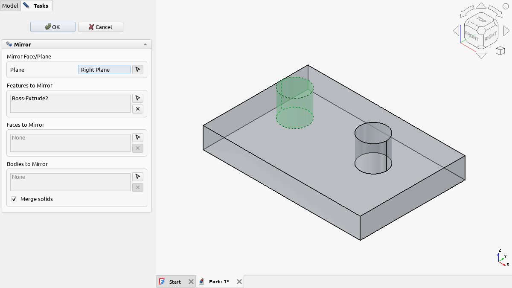

<!-- Generated by docs/build.py from docs/_data/catalog.json, docs/_authored/tools/mirror.md, docs/_data/panels.json. Do not edit this file: change its sources and run `pixi run docs`. -->

# Mirror

{ .tool-icon }
Mirrors features or bodies about a face or plane.
{ .tool-lead }

Mirror copies features or whole bodies to the other side of a face or plane.

## How to use it

1. Select what to mirror (features in the tree, faces, or bodies) and the plane or flat face to mirror about.
2. Click **Mirror**.
3. Check the boxes: **Plane**, then **Features to Mirror**, **Faces to Mirror** or **Bodies to Mirror**.
4. Click **OK**.

## Good to know

- Mirroring bodies makes new bodies; **Merge solids** joins them to the originals where they touch.

## Where to find it

- The **Features** toolbar.
- **Solid Design** → **Features** → **Mirror**
- **Solid Design** → **Patterns** → **Mirror**
- **Insert** → **Features** → **Mirror**
- **Insert** → **Pattern/Mirror** → **Mirror**
- Command search: press <kbd>/</kbd> in the 3D view and type its name.
- The command line: <kbd>:</kbd> then `mirror` ([below](#on-the-command-line)).

## The panel

Every control's tooltip says the same as here: hover over it in FreeCAD. **OK** (or <kbd>Enter</kbd>) makes the feature, **Cancel** (or <kbd>Esc</kbd>) leaves the model as it was.

### Mirror Face/Plane

| Control | Kind | What it does |
| :-- | :-- | :-- |
| **Plane** | Selection box: click a plane or face | The plane or planar face to mirror about |

### Features to Mirror

| Control | Kind | What it does |
| :-- | :-- | :-- |
| **Features** | Selection list: click features in the tree, or their faces | The features to mirror: click them in the tree, or click a face they made |

### Faces to Mirror

| Control | Kind | What it does |
| :-- | :-- | :-- |
| **Faces** | Selection list: click faces | Every face of a boss, hole or pocket to mirror (its walls and top or floor). Material is added where they bound material, cut where they bound a gap. |

### Bodies to Mirror

| Control | Kind | What it does |
| :-- | :-- | :-- |
| **Bodies** | Selection list: click bodies in the 3D view or tree | Whole bodies to mirror |
| **Merge solids** | A check box | Fuse each mirrored body with its original where they touch |

## On the command line

Press <kbd>:</kbd> in the 3D view and type `mirror`, then what to set. See [the command line](../../guides/keyboard.md) for how it works.

??? note "Options it takes"

    | Option | How to type it | What it is |
    | :-- | :-- | :-- |
    | `MergeSolids` | `mergesolids` turns it on, `mergesolids=no` off | Merge mirrored bodies with the originals they touch |

## Properties

??? info "All properties"

    What the feature stores, as the **Property** editor shows it (select the feature in the tree, then the **Data** tab). The panel sets these for you.

    | Property | Kind | Default | What it is |
    | :-- | :-- | :-- | :-- |
    | `Features` | Objects | – | Features to repeat |
    | `Bodies` | List | – | Bodies to repeat, by ID |
    | `Faces` | Picks | – | Faces to repeat: every face of a boss, hole or pocket |
    | `MirrorPlane` | Picks | – | Mirror face or plane |
    | `MergeSolids` | Yes/No | Yes | Merge mirrored bodies with the originals they touch |

