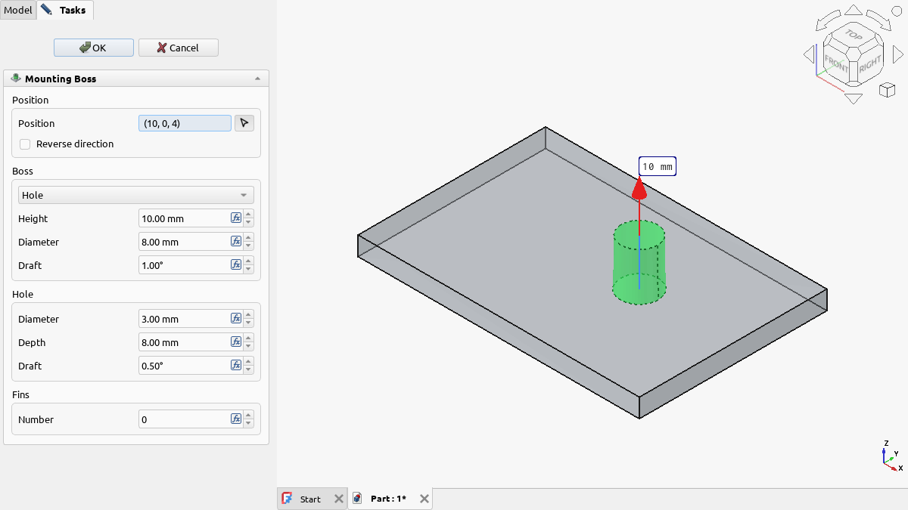

<!-- Generated by docs/build.py from docs/_data/catalog.json, docs/_authored/tools/mounting-boss.md, docs/_data/panels.json. Do not edit this file: change its sources and run `pixi run docs`. -->

# Mounting Boss

{ .tool-icon }
Adds a round boss on a face, with a hole or a pin and optional fins: click where it goes.
{ .tool-lead }

Mounting Boss adds a screw boss in one go: the boss, its hole or pin, draft, and fins to brace it. Made for plastic parts.

## How to use it

1. Click **Mounting Boss**.
2. Click on the face where it stands.
3. Choose **Hole** (for a screw) or **Pin** (to locate a part), and set the boss's **Height**, **Diameter** and **Draft**.
4. Set the hole or pin, and the number of **Fins** (0 for none).
5. Click **OK**.

## Where to find it

- The **Features** toolbar, in the **Fastening Features** drop-down.
- **Solid Design** → **Features** → **Mounting Boss**
- Command search: press <kbd>/</kbd> in the 3D view and type its name.
- The command line: <kbd>:</kbd> then `mountingboss` ([below](#on-the-command-line)).

## The panel

Every control's tooltip says the same as here: hover over it in FreeCAD. **OK** (or <kbd>Enter</kbd>) makes the feature, **Cancel** (or <kbd>Esc</kbd>) leaves the model as it was.

### Position

| Control | Kind | What it does |
| :-- | :-- | :-- |
| **Position** | Selection box: click on a face | Where the boss stands: click on a face |
| **Reverse direction** | A check box | Stand the other way off the face |

### Boss

| Control | Kind | What it does |
| :-- | :-- | :-- |
|  | One of: *Hole*, *Pin* | Hole: a hole down the boss for a screw or an insert. Pin: a pin on top. |
| **Height** | A length | Boss height, from the face |
| **Diameter** | A length | Boss diameter at the face |
| **Draft** | An angle | Draft on the boss's outside |

### Hole

| Control | Kind | What it does |
| :-- | :-- | :-- |
| **Diameter** | A length | Hole diameter at the top |
| **Depth** | A length | Hole depth, from the top |
| **Draft** | An angle | Draft in the hole |

### Pin

*Shown only for some choices above.*

| Control | Kind | What it does |
| :-- | :-- | :-- |
| **Diameter** | A length | Pin diameter |
| **Height** | A length | Pin height, above the boss |

### Fins

Fins tie the boss to the wall round it

| Control | Kind | What it does |
| :-- | :-- | :-- |
| **Number** | A count | Number of fins (0: none) |
| **Length** | A length | How far the fins reach out *(shown for some choices only)* |
| **Height** | A length | Fin height, from the face *(shown for some choices only)* |
| **Thickness** | A length | Fin thickness *(shown for some choices only)* |
| **Angle** | An angle | Turns the fins round the boss *(shown for some choices only)* |

## Drag handles

While the panel is open, drag the handles in the 3D view to set **Height**, or click a handle's value and type. The same handles show when you select the feature in the tree, so you can change it without opening the panel. See [drag handles](../../guides/drag-handles.md).

## On the command line

Press <kbd>:</kbd> in the 3D view and type `mountingboss`, then what to set. See [the command line](../../guides/keyboard.md) for how it works.

Values typed straight after the name set, in order: **Height**. For example `:mountingboss 10`.

??? note "Options it takes"

    | Option | How to type it | What it is |
    | :-- | :-- | :-- |
    | `ReverseDirection` | `reversedirection` turns it on, `reversedirection=no` off | Stand the other way off the face |
    | `BossType` | a word: `hole`, `pin` | Hole: a hole down the boss (for a screw or insert). Pin: a pin on top |
    | `Height` | `height=`a value | Boss height, from the face |
    | `Diameter` | `diameter=`a value | Boss diameter at the face |
    | `Draft` | `draft=`a value | Draft on the boss's outside |
    | `HoleDiameter` | `holediameter=`a value | Hole diameter at the top |
    | `HoleDepth` | `holedepth=`a value | Hole depth, from the top |
    | `HoleDraft` | `holedraft=`a value | Draft in the hole |
    | `PinDiameter` | `pindiameter=`a value | Pin diameter |
    | `PinHeight` | `pinheight=`a value | Pin height, above the boss |
    | `Fins` | `fins=`a whole number | Number of fins (0: none) |
    | `FinLength` | `finlength=`a value | How far the fins reach out from the boss |
    | `FinHeight` | `finheight=`a value | Fin height, from the face |
    | `FinThickness` | `finthickness=`a value | Fin thickness |
    | `FinAngle` | `finangle=`a value | Turns the fins round the boss |

## Properties

??? info "All properties"

    What the feature stores, as the **Property** editor shows it (select the feature in the tree, then the **Data** tab). The panel sets these for you.

    | Property | Kind | Default | What it is |
    | :-- | :-- | :-- | :-- |
    | `Items` | Picks | – | The face it stands on |
    | `Position` | Text |  | Where on the face (x,y,z) |
    | `ReverseDirection` | Yes/No | No | Stand the other way off the face |
    | `BossType` | Choice | Hole | Hole: a hole down the boss (for a screw or insert). Pin: a pin on top Choices: *Hole*, *Pin*. |
    | `Height` | Length | 10 mm | Boss height, from the face |
    | `Diameter` | Length | 8 mm | Boss diameter at the face |
    | `Draft` | Angle | 1° | Draft on the boss's outside |
    | `HoleDiameter` | Length | 3 mm | Hole diameter at the top |
    | `HoleDepth` | Length | 8 mm | Hole depth, from the top |
    | `HoleDraft` | Angle | 0.5° | Draft in the hole |
    | `PinDiameter` | Length | 3 mm | Pin diameter |
    | `PinHeight` | Length | 4 mm | Pin height, above the boss |
    | `Fins` | Whole number | 0 | Number of fins (0: none) |
    | `FinLength` | Length | 4 mm | How far the fins reach out from the boss |
    | `FinHeight` | Length | 6 mm | Fin height, from the face |
    | `FinThickness` | Length | 1 mm | Fin thickness |
    | `FinAngle` | Angle | 0° | Turns the fins round the boss |

