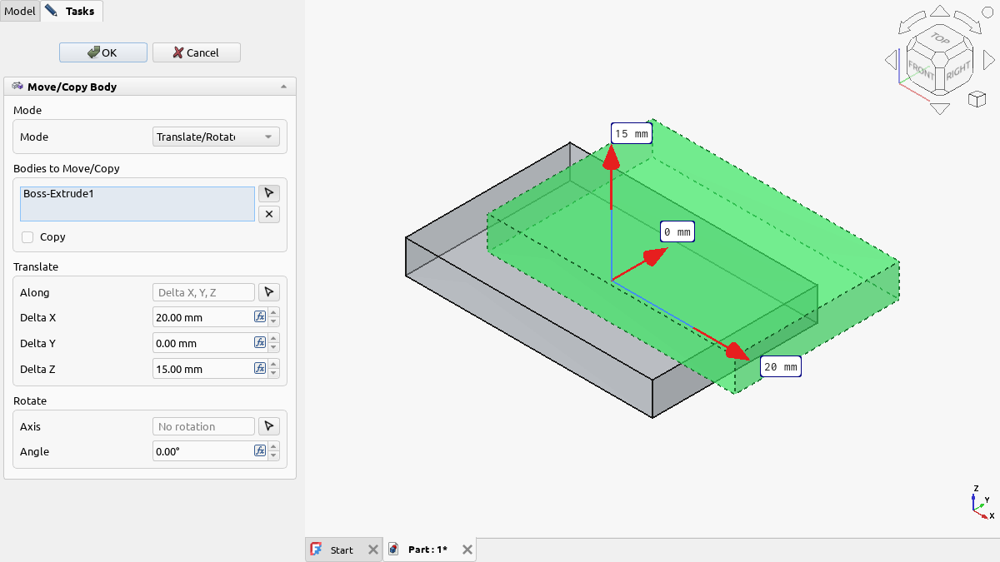

<!-- Generated by docs/build.py from docs/_data/catalog.json, docs/_authored/tools/move-copy-body.md, docs/_data/panels.json. Do not edit this file: change its sources and run `pixi run docs`. -->

# Move/Copy Body

{ .tool-icon }
Moves or copies bodies by a translation and a rotation.
{ .tool-lead }

Move/Copy Body moves bodies, or copies them, by a distance and a rotation, or by mating them to other geometry.

## How to use it

1. Select the bodies and click **Move/Copy Body**.
2. Tick **Copy** to leave the original where it is.
3. Type **Delta X**, **Delta Y** and **Delta Z**, or drag the arrows; pick an **Axis** and an **Angle** to turn them.
4. Click **OK**.

## Good to know

- The **Mode** switch has a second way: **Constraints**, which places a body by mating its faces and edges to others, as SolidWorks' Move/Copy Body does.

## Where to find it

- The **Bodies** toolbar.
- **Solid Design** → **Bodies** → **Move/Copy Body**
- **Insert** → **Features** → **Move/Copy Body**
- Command search: press <kbd>/</kbd> in the 3D view and type its name.
- The command line: <kbd>:</kbd> then `movecopybody` ([below](#on-the-command-line)).

## The panel

Every control's tooltip says the same as here: hover over it in FreeCAD. **OK** (or <kbd>Enter</kbd>) makes the feature, **Cancel** (or <kbd>Esc</kbd>) leaves the model as it was.

### Mode

| Control | Kind | What it does |
| :-- | :-- | :-- |
| **Mode** | One of: *Translate/Rotate*, *Constraints* | Translate/Rotate: move by distances and angles. Constraints: place the bodies by mating their faces, edges and points to others. |

### Bodies to Move/Copy

| Control | Kind | What it does |
| :-- | :-- | :-- |
| **Bodies** | Selection list: click bodies in the 3D view or tree | The bodies to move or copy |
| **Copy** | A check box | Leave the bodies where they are and move copies of them |
| **Number of copies** | A count | How many copies, each one step further on *(shown for some choices only)* |

### Translate

| Control | Kind | What it does |
| :-- | :-- | :-- |
| **Along** | Selection box: click an edge or axis | Move along this edge or axis by the distance. Empty: move by Delta X, Y and Z. |
| **Distance** | A length | How far to move along the edge or axis *(a flip button beside it; shown for some choices only)* |
| **Delta X** | A length | Distance to move along X |
| **Delta Y** | A length | Distance to move along Y |
| **Delta Z** | A length | Distance to move along Z |

### Rotate

| Control | Kind | What it does |
| :-- | :-- | :-- |
| **Axis** | Selection box: click an axis or edge | The axis to turn the bodies about: an axis, a straight edge or a round face |
| **Angle** | An angle | How far to turn the bodies |

### Constraint 1

*Shown only for some choices above.*

| Control | Kind | What it does |
| :-- | :-- | :-- |
| **Type** | One of: *None*, *Coincident*, *Parallel*, *Perpendicular*, *Distance*, *Angle*, *Concentric* | Coincident, Parallel, Perpendicular, Distance, Angle or Concentric. All the constraints are met together. |
| **Moving** | Selection box: click a moving body | A face, edge or vertex of a body being moved *(shown for some choices only)* |
| **Against** | Selection box: click what it goes against | The face, edge or point it goes against, on a body that isn't moved *(shown for some choices only)* |
| **Value** | A number | The distance or angle between them *(shown for some choices only)* |
| **Flip alignment** | A check box | Face the other way: aligned instead of opposed *(shown for some choices only)* |

### Constraint 2

*Shown only for some choices above.*

| Control | Kind | What it does |
| :-- | :-- | :-- |
| **Type** | One of: *None*, *Coincident*, *Parallel*, *Perpendicular*, *Distance*, *Angle*, *Concentric* | Coincident, Parallel, Perpendicular, Distance, Angle or Concentric. All the constraints are met together. |
| **Moving** | Selection box: click a moving body | A face, edge or vertex of a body being moved *(shown for some choices only)* |
| **Against** | Selection box: click what it goes against | The face, edge or point it goes against, on a body that isn't moved *(shown for some choices only)* |
| **Value** | A number | The distance or angle between them *(shown for some choices only)* |
| **Flip alignment** | A check box | Face the other way: aligned instead of opposed *(shown for some choices only)* |

### Constraint 3

*Shown only for some choices above.*

| Control | Kind | What it does |
| :-- | :-- | :-- |
| **Type** | One of: *None*, *Coincident*, *Parallel*, *Perpendicular*, *Distance*, *Angle*, *Concentric* | Coincident, Parallel, Perpendicular, Distance, Angle or Concentric. All the constraints are met together. |
| **Moving** | Selection box: click a moving body | A face, edge or vertex of a body being moved *(shown for some choices only)* |
| **Against** | Selection box: click what it goes against | The face, edge or point it goes against, on a body that isn't moved *(shown for some choices only)* |
| **Value** | A number | The distance or angle between them *(shown for some choices only)* |
| **Flip alignment** | A check box | Face the other way: aligned instead of opposed *(shown for some choices only)* |

### Constraint 4

*Shown only for some choices above.*

| Control | Kind | What it does |
| :-- | :-- | :-- |
| **Type** | One of: *None*, *Coincident*, *Parallel*, *Perpendicular*, *Distance*, *Angle*, *Concentric* | Coincident, Parallel, Perpendicular, Distance, Angle or Concentric. All the constraints are met together. |
| **Moving** | Selection box: click a moving body | A face, edge or vertex of a body being moved *(shown for some choices only)* |
| **Against** | Selection box: click what it goes against | The face, edge or point it goes against, on a body that isn't moved *(shown for some choices only)* |
| **Value** | A number | The distance or angle between them *(shown for some choices only)* |
| **Flip alignment** | A check box | Face the other way: aligned instead of opposed *(shown for some choices only)* |

### Constraint 5

*Shown only for some choices above.*

| Control | Kind | What it does |
| :-- | :-- | :-- |
| **Type** | One of: *None*, *Coincident*, *Parallel*, *Perpendicular*, *Distance*, *Angle*, *Concentric* | Coincident, Parallel, Perpendicular, Distance, Angle or Concentric. All the constraints are met together. |
| **Moving** | Selection box: click a moving body | A face, edge or vertex of a body being moved *(shown for some choices only)* |
| **Against** | Selection box: click what it goes against | The face, edge or point it goes against, on a body that isn't moved *(shown for some choices only)* |
| **Value** | A number | The distance or angle between them *(shown for some choices only)* |
| **Flip alignment** | A check box | Face the other way: aligned instead of opposed *(shown for some choices only)* |

### Constraint 6

*Shown only for some choices above.*

| Control | Kind | What it does |
| :-- | :-- | :-- |
| **Type** | One of: *None*, *Coincident*, *Parallel*, *Perpendicular*, *Distance*, *Angle*, *Concentric* | Coincident, Parallel, Perpendicular, Distance, Angle or Concentric. All the constraints are met together. |
| **Moving** | Selection box: click a moving body | A face, edge or vertex of a body being moved *(shown for some choices only)* |
| **Against** | Selection box: click what it goes against | The face, edge or point it goes against, on a body that isn't moved *(shown for some choices only)* |
| **Value** | A number | The distance or angle between them *(shown for some choices only)* |
| **Flip alignment** | A check box | Face the other way: aligned instead of opposed *(shown for some choices only)* |

## Drag handles

While the panel is open, drag the handles in the 3D view to set **DeltaX**, **DeltaY**, **DeltaZ**, or click a handle's value and type. The same handles show when you select the feature in the tree, so you can change it without opening the panel. See [drag handles](../../guides/drag-handles.md).

## On the command line

Press <kbd>:</kbd> in the 3D view and type `movecopybody`, then what to set. See [the command line](../../guides/keyboard.md) for how it works.

Values typed straight after the name set, in order: **DeltaX**, **DeltaY**, **DeltaZ**. For example `:movecopybody 0 0 0`.

??? note "Options it takes"

    | Option | How to type it | What it is |
    | :-- | :-- | :-- |
    | `Copy` | `copy` turns it on, `copy=no` off | Copy instead of moving |
    | `Copies` | `copies=`a whole number | Number of copies |
    | `TranslateDistance` | `translatedistance=`a value | Distance along the reference |
    | `DeltaX` | `deltax=`a value | Delta X |
    | `DeltaY` | `deltay=`a value | Delta Y |
    | `DeltaZ` | `deltaz=`a value | Delta Z |
    | `ReverseTranslate` | `reversetranslate` turns it on, `reversetranslate=no` off | Reverse direction |
    | `Angle` | `angle=`a value | Rotation angle |
    | `MoveMode` | a word: `translaterotate`, `constraints` | How the bodies are placed |
    | `MateType1` | a word: `none`, `coincident`, `parallel`, `perpendicular`, `distance`, `angle`, `concentric` | Constraint 1 |
    | `MateValue1` | `matevalue1=`a value | Constraint 1: distance (mm) or angle (degrees) |
    | `MateFlip1` | `mateflip1` turns it on, `mateflip1=no` off | Constraint 1: flip alignment |
    | `MateType2` | a word: `none`, `coincident`, `parallel`, `perpendicular`, `distance`, `angle`, `concentric` | Constraint 2 |
    | `MateValue2` | `matevalue2=`a value | Constraint 2: distance (mm) or angle (degrees) |
    | `MateFlip2` | `mateflip2` turns it on, `mateflip2=no` off | Constraint 2: flip alignment |
    | `MateType3` | a word: `none`, `coincident`, `parallel`, `perpendicular`, `distance`, `angle`, `concentric` | Constraint 3 |
    | `MateValue3` | `matevalue3=`a value | Constraint 3: distance (mm) or angle (degrees) |
    | `MateFlip3` | `mateflip3` turns it on, `mateflip3=no` off | Constraint 3: flip alignment |
    | `MateType4` | a word: `none`, `coincident`, `parallel`, `perpendicular`, `distance`, `angle`, `concentric` | Constraint 4 |
    | `MateValue4` | `matevalue4=`a value | Constraint 4: distance (mm) or angle (degrees) |
    | `MateFlip4` | `mateflip4` turns it on, `mateflip4=no` off | Constraint 4: flip alignment |
    | `MateType5` | a word: `none`, `coincident`, `parallel`, `perpendicular`, `distance`, `angle`, `concentric` | Constraint 5 |
    | `MateValue5` | `matevalue5=`a value | Constraint 5: distance (mm) or angle (degrees) |
    | `MateFlip5` | `mateflip5` turns it on, `mateflip5=no` off | Constraint 5: flip alignment |
    | `MateType6` | a word: `none`, `coincident`, `parallel`, `perpendicular`, `distance`, `angle`, `concentric` | Constraint 6 |
    | `MateValue6` | `matevalue6=`a value | Constraint 6: distance (mm) or angle (degrees) |
    | `MateFlip6` | `mateflip6` turns it on, `mateflip6=no` off | Constraint 6: flip alignment |

## Properties

??? info "All properties"

    What the feature stores, as the **Property** editor shows it (select the feature in the tree, then the **Data** tab). The panel sets these for you.

    | Property | Kind | Default | What it is |
    | :-- | :-- | :-- | :-- |
    | `Bodies` | List | – | Bodies to move or copy, by ID |
    | `Copy` | Yes/No | No | Copy instead of moving |
    | `Copies` | Whole number | 1 | Number of copies |
    | `TranslateReference` | Picks | – | Edge or axis to translate along (instead of Delta X/Y/Z) |
    | `TranslateDistance` | Length | 0 mm | Distance along the reference |
    | `DeltaX` | Length | 0 mm | Delta X |
    | `DeltaY` | Length | 0 mm | Delta Y |
    | `DeltaZ` | Length | 0 mm | Delta Z |
    | `ReverseTranslate` | Yes/No | No | Reverse direction |
    | `RotateReference` | Picks | – | Axis or edge to rotate about |
    | `Angle` | Angle | 0° | Rotation angle |
    | `MoveMode` | Choice | Translate/Rotate | How the bodies are placed Choices: *Translate/Rotate*, *Constraints*. |
    | `MateType1` | Choice | None | Constraint 1 Choices: *None*, *Coincident*, *Parallel*, *Perpendicular*, *Distance*, *Angle*, *Concentric*. |
    | `MateMoving1` | Picks | – | Constraint 1: face, edge or vertex of the moving bodies |
    | `MateFixed1` | Picks | – | Constraint 1: what it is placed against |
    | `MateValue1` | Number | 0 | Constraint 1: distance (mm) or angle (degrees) |
    | `MateFlip1` | Yes/No | No | Constraint 1: flip alignment |
    | `MateType2` | Choice | None | Constraint 2 Choices: *None*, *Coincident*, *Parallel*, *Perpendicular*, *Distance*, *Angle*, *Concentric*. |
    | `MateMoving2` | Picks | – | Constraint 2: face, edge or vertex of the moving bodies |
    | `MateFixed2` | Picks | – | Constraint 2: what it is placed against |
    | `MateValue2` | Number | 0 | Constraint 2: distance (mm) or angle (degrees) |
    | `MateFlip2` | Yes/No | No | Constraint 2: flip alignment |
    | `MateType3` | Choice | None | Constraint 3 Choices: *None*, *Coincident*, *Parallel*, *Perpendicular*, *Distance*, *Angle*, *Concentric*. |
    | `MateMoving3` | Picks | – | Constraint 3: face, edge or vertex of the moving bodies |
    | `MateFixed3` | Picks | – | Constraint 3: what it is placed against |
    | `MateValue3` | Number | 0 | Constraint 3: distance (mm) or angle (degrees) |
    | `MateFlip3` | Yes/No | No | Constraint 3: flip alignment |
    | `MateType4` | Choice | None | Constraint 4 Choices: *None*, *Coincident*, *Parallel*, *Perpendicular*, *Distance*, *Angle*, *Concentric*. |
    | `MateMoving4` | Picks | – | Constraint 4: face, edge or vertex of the moving bodies |
    | `MateFixed4` | Picks | – | Constraint 4: what it is placed against |
    | `MateValue4` | Number | 0 | Constraint 4: distance (mm) or angle (degrees) |
    | `MateFlip4` | Yes/No | No | Constraint 4: flip alignment |
    | `MateType5` | Choice | None | Constraint 5 Choices: *None*, *Coincident*, *Parallel*, *Perpendicular*, *Distance*, *Angle*, *Concentric*. |
    | `MateMoving5` | Picks | – | Constraint 5: face, edge or vertex of the moving bodies |
    | `MateFixed5` | Picks | – | Constraint 5: what it is placed against |
    | `MateValue5` | Number | 0 | Constraint 5: distance (mm) or angle (degrees) |
    | `MateFlip5` | Yes/No | No | Constraint 5: flip alignment |
    | `MateType6` | Choice | None | Constraint 6 Choices: *None*, *Coincident*, *Parallel*, *Perpendicular*, *Distance*, *Angle*, *Concentric*. |
    | `MateMoving6` | Picks | – | Constraint 6: face, edge or vertex of the moving bodies |
    | `MateFixed6` | Picks | – | Constraint 6: what it is placed against |
    | `MateValue6` | Number | 0 | Constraint 6: distance (mm) or angle (degrees) |
    | `MateFlip6` | Yes/No | No | Constraint 6: flip alignment |

