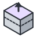
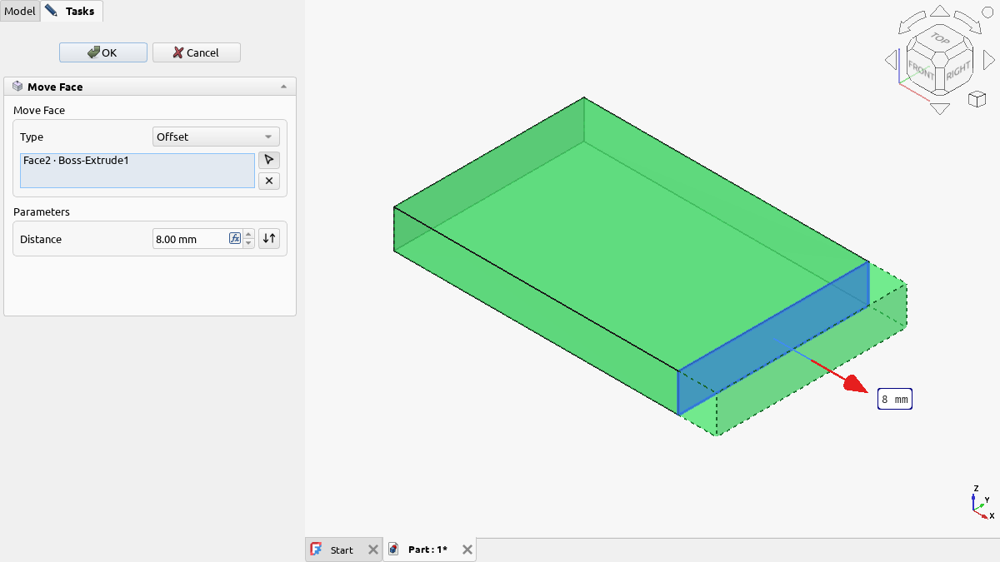

<!-- Generated by docs/build.py from docs/_data/catalog.json, docs/_authored/tools/move-face.md, docs/_data/panels.json. Do not edit this file: change its sources and run `pixi run docs`. -->

# Move Face

{ .tool-icon }
Moves faces of a solid (offset, translate or rotate); the faces around them extend or trim to follow.
{ .tool-lead }

Move Face moves faces of a solid directly: offset them, slide them, or turn them. The faces around them stretch or trim to follow. Useful on imported parts with no history.

## How to use it

1. Select the faces and click **Move Face**.
2. Choose **Offset**, **Translate** or **Rotate**.
3. Set the distance (or angle), or drag the arrow.
4. Click **OK**.

## Where to find it

- The **Bodies** toolbar.
- **Solid Design** → **Bodies** → **Move Face**
- **Insert** → **Features** → **Move Face**
- Command search: press <kbd>/</kbd> in the 3D view and type its name.
- The command line: <kbd>:</kbd> then `moveface` ([below](#on-the-command-line)).

## The panel

Every control's tooltip says the same as here: hover over it in FreeCAD. **OK** (or <kbd>Enter</kbd>) makes the feature, **Cancel** (or <kbd>Esc</kbd>) leaves the model as it was.

### Move Face

| Control | Kind | What it does |
| :-- | :-- | :-- |
| **Type** | One of: *Offset*, *Translate*, *Rotate* | Offset: along the faces' normals. Translate: along a direction. Rotate: about an axis. The faces around them extend or trim to follow. |
| **Faces** | Selection list: click faces | The faces to move. Click a face again to take it out. |

### Parameters

| Control | Kind | What it does |
| :-- | :-- | :-- |
| **Distance** | A length | How far to move the faces *(a flip button beside it)* |
| **Direction** | Selection box: click an edge, axis or face | The direction to move along: a straight edge, an axis, or a face (its normal) *(shown for some choices only)* |
| **Axis** | Selection box: click an edge or axis | The axis to turn the faces about; parallel to them *(shown for some choices only)* |
| **Angle** | An angle | How far to turn the faces *(shown for some choices only)* |

## Drag handles

While the panel is open, drag the handles in the 3D view to set **Distance**, or click a handle's value and type. The same handles show when you select the feature in the tree, so you can change it without opening the panel. See [drag handles](../../guides/drag-handles.md).

## On the command line

Press <kbd>:</kbd> in the 3D view and type `moveface`, then what to set. See [the command line](../../guides/keyboard.md) for how it works.

Values typed straight after the name set, in order: **Distance**. For example `:moveface 1`.

??? note "Options it takes"

    | Option | How to type it | What it is |
    | :-- | :-- | :-- |
    | `MoveType` | a word: `offset`, `translate`, `rotate` | Offset, Translate or Rotate |
    | `Distance` | `distance=`a value | Distance (Offset, Translate) |
    | `Angle` | `angle=`a value | Rotate: angle |
    | `Flip` | `flip` turns it on, `flip=no` off | The other way |

## Properties

??? info "All properties"

    What the feature stores, as the **Property** editor shows it (select the feature in the tree, then the **Data** tab). The panel sets these for you.

    | Property | Kind | Default | What it is |
    | :-- | :-- | :-- | :-- |
    | `MoveType` | Choice | Offset | Offset, Translate or Rotate Choices: *Offset*, *Translate*, *Rotate*. |
    | `Items` | Picks | – | Faces to move |
    | `Distance` | Length | 1 mm | Distance (Offset, Translate) |
    | `Direction` | Picks | – | Translate: an edge, axis or face (its normal) to move along |
    | `Axis` | Picks | – | Rotate: an edge or axis to turn about |
    | `Angle` | Angle | 10° | Rotate: angle |
    | `Flip` | Yes/No | No | The other way |

