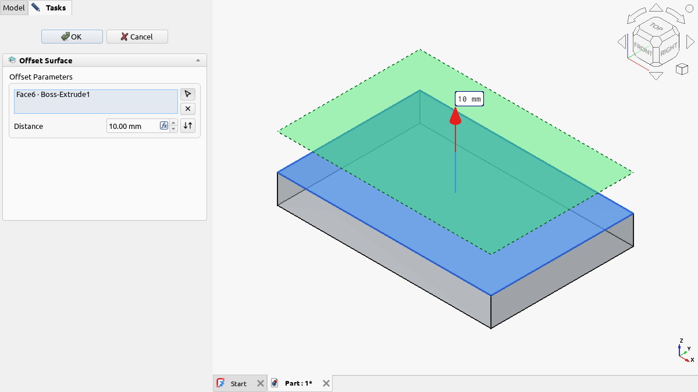

<!-- Generated by docs/build.py from docs/_data/catalog.json, docs/_authored/tools/offset-surface.md, docs/_data/panels.json. Do not edit this file: change its sources and run `pixi run docs`. -->

# Offset Surface

{ .tool-icon }
Offsets faces or surfaces by a distance into a new surface body (0: a copy).
{ .tool-lead }

Offset Surface copies faces at a distance into a new surface body. With a distance of 0 it is a plain copy.

## How to use it

1. Select the faces (of a solid or a surface).
2. Click **Offset Surface**, set the **Distance** (or drag the arrow), flip it if needed.
3. Click **OK**.

## Where to find it

- The **Surfaces** toolbar.
- **Solid Design** → **Surfaces** → **Offset Surface**
- **Insert** → **Surface** → **Offset Surface**
- Command search: press <kbd>/</kbd> in the 3D view and type its name.
- The command line: <kbd>:</kbd> then `offsetsurface` ([below](#on-the-command-line)).

## The panel

Every control's tooltip says the same as here: hover over it in FreeCAD. **OK** (or <kbd>Enter</kbd>) makes the feature, **Cancel** (or <kbd>Esc</kbd>) leaves the model as it was.

### Offset Parameters

| Control | Kind | What it does |
| :-- | :-- | :-- |
| **Faces** | Selection list: click faces | The faces or surfaces to offset into a new surface body. Click a face again to take it out. |
| **Distance** | A length | How far to offset them (0: a copy of the faces) *(a flip button beside it)* |

## Drag handles

While the panel is open, drag the handles in the 3D view to set **Distance**, or click a handle's value and type. The same handles show when you select the feature in the tree, so you can change it without opening the panel. See [drag handles](../../guides/drag-handles.md).

## On the command line

Press <kbd>:</kbd> in the 3D view and type `offsetsurface`, then what to set. See [the command line](../../guides/keyboard.md) for how it works.

Values typed straight after the name set, in order: **Distance**. For example `:offsetsurface 1`.

??? note "Options it takes"

    | Option | How to type it | What it is |
    | :-- | :-- | :-- |
    | `Distance` | `distance=`a value | Offset distance (0: a copy) |
    | `Flip` | `flip` turns it on, `flip=no` off | Offset to the other side |

## Properties

??? info "All properties"

    What the feature stores, as the **Property** editor shows it (select the feature in the tree, then the **Data** tab). The panel sets these for you.

    | Property | Kind | Default | What it is |
    | :-- | :-- | :-- | :-- |
    | `Items` | Picks | – | Faces or surfaces to offset |
    | `Distance` | Length | 1 mm | Offset distance (0: a copy) |
    | `Flip` | Yes/No | No | Offset to the other side |

