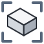
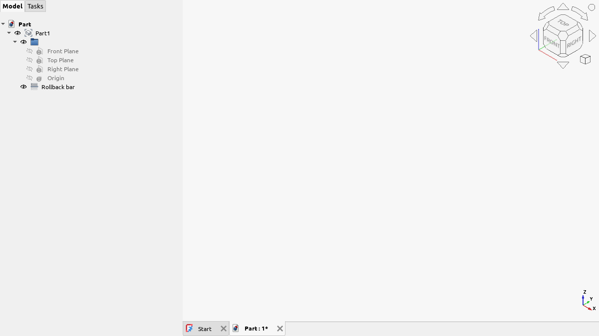

<!-- Generated by docs/build.py from docs/_data/catalog.json, docs/_authored/tools/part.md. Do not edit this file: change its sources and run `pixi run docs`. -->

# Part

{ .tool-icon }
Creates a part with its origin, default planes and body folders.
{ .tool-lead }

A part holds everything you model: its origin (three planes and three axes), its bodies, and its features in order. Start every model with one. It's SolidWorks' part document, inside a FreeCAD document.

## How to use it

1. Open or make a FreeCAD document (**File → New**).
2. Click **Part**. The new part appears in the tree with its **Origin** and its body folders, and becomes the active part: new sketches and features go into it.

## Good to know

- You rarely need to click **Part** yourself: the first sketch or feature in a document without a part makes one.
- A document can hold more than one part. The tools work on the active part.
- See [parts and bodies](../../concepts/parts-and-bodies.md) for how bodies are kept.

## Where to find it

- The **Part** toolbar.
- **Solid Design** → **Part**
- **Insert** → **Part**
- Command search: press <kbd>/</kbd> in the 3D view and type its name.

