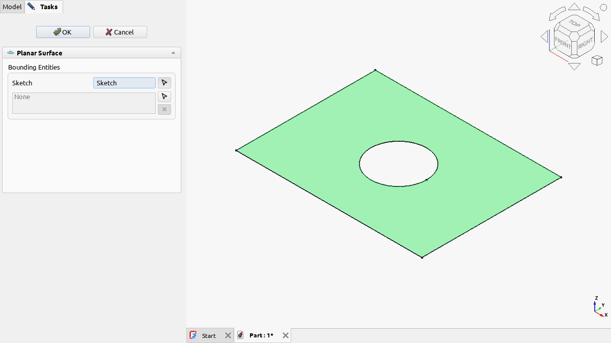

<!-- Generated by docs/build.py from docs/_data/catalog.json, docs/_authored/tools/planar-surface.md, docs/_data/panels.json. Do not edit this file: change its sources and run `pixi run docs`. -->

# Planar Surface

{ .tool-icon }
Makes a flat surface inside a sketch's closed regions or closed, flat loops of edges.
{ .tool-lead }

Planar Surface fills a flat closed outline with a surface: a sketch's closed regions, or a closed flat loop of edges.

## How to use it

1. Select a sketch, or the edges of a flat loop.
2. Click **Planar Surface**, then **OK**.

## Good to know

- Holes in the sketch stay holes in the surface.

## Where to find it

- The **Surfaces** toolbar.
- **Solid Design** → **Surfaces** → **Planar Surface**
- **Insert** → **Surface** → **Planar Surface**
- Command search: press <kbd>/</kbd> in the 3D view and type its name.
- The command line: <kbd>:</kbd> then `planarsurface`.

## The panel

Every control's tooltip says the same as here: hover over it in FreeCAD. **OK** (or <kbd>Enter</kbd>) makes the feature, **Cancel** (or <kbd>Esc</kbd>) leaves the model as it was.

### Bounding Entities

| Control | Kind | What it does |
| :-- | :-- | :-- |
| **Sketch** | Selection box: click a sketch | A sketch: its closed regions become flat faces |
| **Edges** | Selection list: click edges | Or closed loops of model edges in one plane |

## Properties

??? info "All properties"

    What the feature stores, as the **Property** editor shows it (select the feature in the tree, then the **Data** tab). The panel sets these for you.

    | Property | Kind | Default | What it is |
    | :-- | :-- | :-- | :-- |
    | `Sketch` | Object | – | A sketch whose closed regions become faces |
    | `Items` | Picks | – | Closed, flat loops of model edges |

