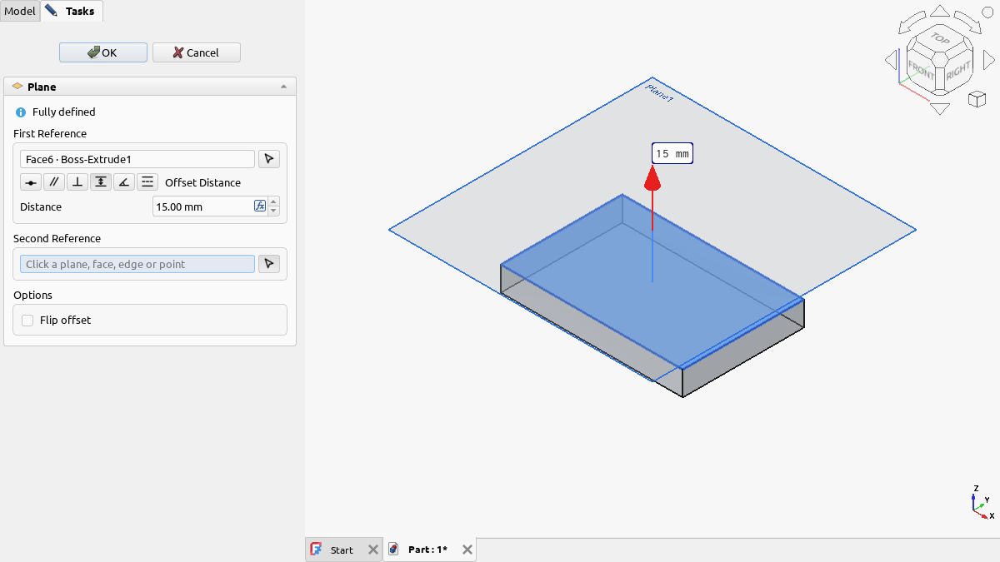

<!-- Generated by docs/build.py from docs/_data/catalog.json, docs/_authored/tools/plane.md, docs/_data/panels.json. Do not edit this file: change its sources and run `pixi run docs`. -->

# Plane

{ .tool-icon }
Adds a reference plane.
{ .tool-lead }

Plane adds a reference plane to sketch on, mirror about or cut with. Pick up to three references and it works out the plane, as SolidWorks does.

## How to use it

1. Select up to three references: faces, planes, edges, axes, vertices or points.
2. Click **Plane**. It guesses the plane from what you picked (a face alone: an offset plane; two edges: a plane through them...).
3. Under each reference, change how the plane relates to it if the guess isn't what you want: **Coincident**, **Parallel**, **Perpendicular**, **Offset Distance**, **At Angle**, **Mid Plane**, **Tangent**.
4. Set the distance or angle (or drag the arrow), then click **OK**.

## Good to know

- The panel says **Fully defined** when the references are enough.
- Its name shows in the 3D view, at its top left corner: see [Reference Names](reference-names.md).
- See [reference geometry](../../guides/reference-geometry.md).

## Where to find it

- The **Reference Geometry** toolbar, in the **Reference Geometry** drop-down.
- **Solid Design** → **Reference Geometry** → **Plane**
- **Insert** → **Reference Geometry** → **Plane**
- Command search: press <kbd>/</kbd> in the 3D view and type its name.
- The command line: <kbd>:</kbd> then `plane` ([below](#on-the-command-line)).

## The panel

Every control's tooltip says the same as here: hover over it in FreeCAD. **OK** (or <kbd>Enter</kbd>) makes the feature, **Cancel** (or <kbd>Esc</kbd>) leaves the model as it was.

### First Reference

A plane, face, edge or point the new plane is placed by

| Control | Kind | What it does |
| :-- | :-- | :-- |
| **Reference** | Selection box: click a plane, face, edge or point | A plane, face, edge or point the new plane is placed by |
|  | A button | *(a flip button beside it; a flip button beside it; a flip button beside it; a flip button beside it; a flip button beside it; a flip button beside it)* |
| **Distance** | A number | Distance from the reference |
| **Angle** | A number | Angle turned about the edge or axis *(shown for some choices only)* |

### Second Reference

A plane, face, edge or point the new plane is placed by

| Control | Kind | What it does |
| :-- | :-- | :-- |
| **Reference** | Selection box: click a plane, face, edge or point | A plane, face, edge or point the new plane is placed by |
|  | A button | *(a flip button beside it; a flip button beside it; a flip button beside it; a flip button beside it; a flip button beside it; a flip button beside it; shown for some choices only)* |
| **Distance** | A number | Distance from the reference *(shown for some choices only)* |
| **Angle** | A number | Angle turned about the edge or axis *(shown for some choices only)* |

### Third Reference

A plane, face, edge or point the new plane is placed by

*Shown only for some choices above.*

| Control | Kind | What it does |
| :-- | :-- | :-- |
| **Reference** | Selection box: click a plane, face, edge or point | A plane, face, edge or point the new plane is placed by |
|  | A button | *(a flip button beside it; a flip button beside it; a flip button beside it; a flip button beside it; a flip button beside it; a flip button beside it; shown for some choices only)* |
| **Distance** | A number | Distance from the reference *(shown for some choices only)* |
| **Angle** | A number | Angle turned about the edge or axis *(shown for some choices only)* |

### Options

| Control | Kind | What it does |
| :-- | :-- | :-- |
| **Flip offset** | A check box | Turn the plane the other way round |

## Drag handles

While the panel is open, drag the handles in the 3D view to set **Distance**, or click a handle's value and type. The same handles show when you select the feature in the tree, so you can change it without opening the panel. See [drag handles](../../guides/drag-handles.md).

## On the command line

Press <kbd>:</kbd> in the 3D view and type `plane`, then what to set. See [the command line](../../guides/keyboard.md) for how it works.

Values typed straight after the name set, in order: **Distance**. For example `:plane 10`.

??? note "Options it takes"

    | Option | How to type it | What it is |
    | :-- | :-- | :-- |
    | `Type` | a word: `references`, `coincident`, `offsetdistance`, `atangle`, `throughpoints`, `parallelatpoint`, `normaltocurve`, `midplane` | How it is defined |
    | `Flip` | `flip` turns it on, `flip=no` off | Flip |

## Properties

??? info "All properties"

    What the feature stores, as the **Property** editor shows it (select the feature in the tree, then the **Data** tab). The panel sets these for you.

    | Property | Kind | Default | What it is |
    | :-- | :-- | :-- | :-- |
    | `Type` | Choice | References | How it is defined Choices: *References*, *Coincident*, *Offset Distance*, *At Angle*, *Through Points*, *Parallel at Point*, *Normal to Curve*, *Mid Plane*. |
    | `Reference1` | Picks | – | Reference 1 |
    | `Reference2` | Picks | – | Reference 2 |
    | `Reference3` | Picks | – | Reference 3 |
    | `Flip` | Yes/No | No | Flip |

