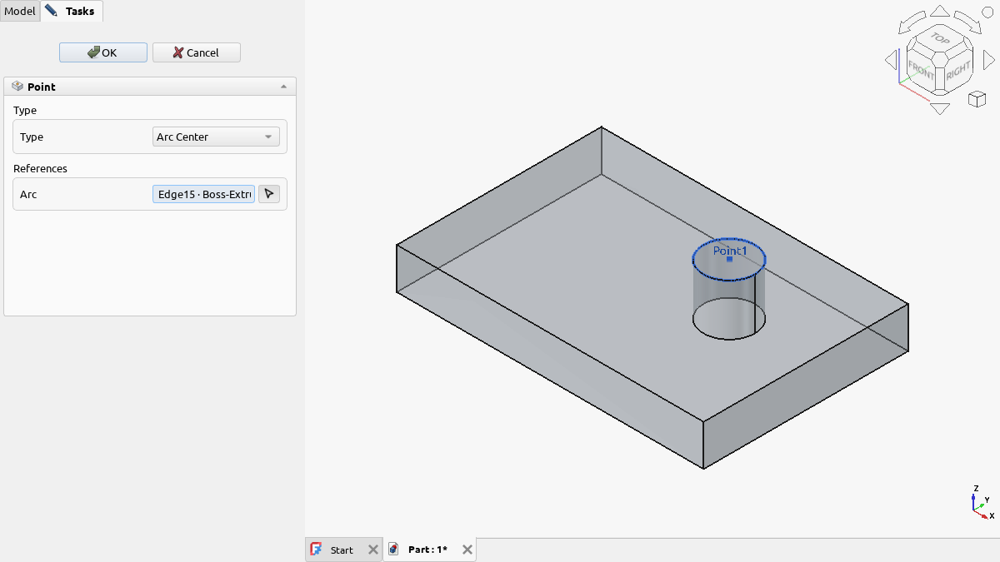

<!-- Generated by docs/build.py from docs/_data/catalog.json, docs/_authored/tools/point.md, docs/_data/panels.json. Do not edit this file: change its sources and run `pixi run docs`. -->

# Point

{ .tool-icon }
Adds a reference point: an arc's centre, a face's centre, where an edge meets a face, a projection, or a distance along an edge.
{ .tool-lead }

Point adds a reference point: the centre of an arc or a face, where an edge meets a face, a point projected onto a face, or a distance along an edge.

## How to use it

1. Select the reference (an arc, a face, an edge and a face...).
2. Click **Point**. It picks the **Type** that fits; choose another if you need.
3. Click **OK**.

## Where to find it

- The **Reference Geometry** toolbar, in the **Reference Geometry** drop-down.
- **Solid Design** → **Reference Geometry** → **Point**
- **Insert** → **Reference Geometry** → **Point**
- Command search: press <kbd>/</kbd> in the 3D view and type its name.
- The command line: <kbd>:</kbd> then `point` ([below](#on-the-command-line)).

## The panel

Every control's tooltip says the same as here: hover over it in FreeCAD. **OK** (or <kbd>Enter</kbd>) makes the feature, **Cancel** (or <kbd>Esc</kbd>) leaves the model as it was.

### Type

| Control | Kind | What it does |
| :-- | :-- | :-- |
| **Type** | One of: *Arc Center*, *Center of Face*, *Intersection*, *Projection*, *On Point*, *Along Curve Distance* | How the point is defined; the references below follow from it |

### References

| Control | Kind | What it does |
| :-- | :-- | :-- |
| **Arc** | Selection box: click a circular edge | A reference the point is built from |
| **Reference 2** | Selection box | A reference the point is built from *(shown for some choices only)* |
| **Reference 3** | Selection box | A reference the point is built from *(shown for some choices only)* |

### Options

*Shown only for some choices above.*

| Control | Kind | What it does |
| :-- | :-- | :-- |
| **Distance** | A length | Distance along the edge from its start *(shown for some choices only)* |
| **From the other end** | A check box | Measure the distance from the edge's other end *(shown for some choices only)* |

## On the command line

Press <kbd>:</kbd> in the 3D view and type `point`, then what to set. See [the command line](../../guides/keyboard.md) for how it works.

??? note "Options it takes"

    | Option | How to type it | What it is |
    | :-- | :-- | :-- |
    | `Type` | a word: `arccenter`, `centerofface`, `intersection`, `projection`, `onpoint`, `alongcurvedistance` | How it is defined |
    | `Flip` | `flip` turns it on, `flip=no` off | Flip |
    | `Distance` | `distance=`a value | Distance along the curve (Along Curve Distance) |

## Properties

??? info "All properties"

    What the feature stores, as the **Property** editor shows it (select the feature in the tree, then the **Data** tab). The panel sets these for you.

    | Property | Kind | Default | What it is |
    | :-- | :-- | :-- | :-- |
    | `Type` | Choice | Arc Center | How it is defined Choices: *Arc Center*, *Center of Face*, *Intersection*, *Projection*, *On Point*, *Along Curve Distance*. |
    | `Reference1` | Picks | – | Reference 1 |
    | `Reference2` | Picks | – | Reference 2 |
    | `Reference3` | Picks | – | Reference 3 |
    | `Flip` | Yes/No | No | Flip |
    | `Distance` | Length | 10 mm | Distance along the curve (Along Curve Distance) |

