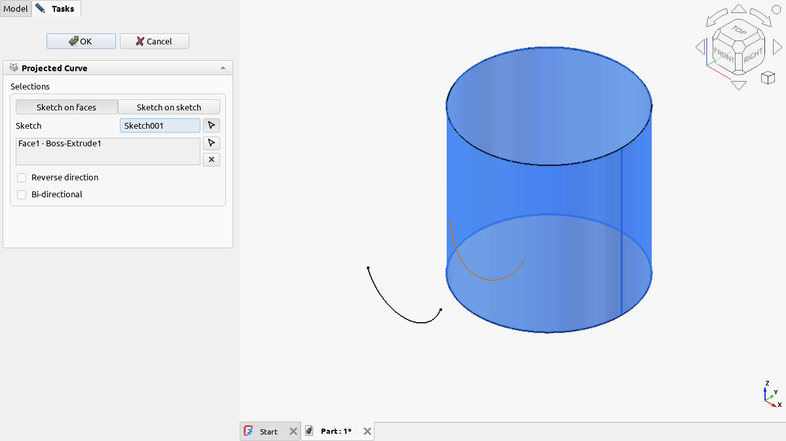

<!-- Generated by docs/build.py from docs/_data/catalog.json, docs/_authored/tools/projected-curve.md, docs/_data/panels.json. Do not edit this file: change its sources and run `pixi run docs`. -->

# Projected Curve

{ .tool-icon }
Projects a sketch onto faces, or makes the curve where two sketches on crossing planes meet.
{ .tool-lead }

Projected Curve makes a 3D curve: a sketch projected onto faces, or where two sketches on crossing planes meet.

## How to use it

1. Select the sketch and the faces (or two sketches) and click **Projected Curve**.
2. Choose **Sketch on faces** or **Sketch on sketch**.
3. Tick **Reverse direction** if the sketch doesn't land on the faces, or **Bi-directional** to project both ways.
4. Click **OK**.

## Where to find it

- The **Curves** toolbar, in the **Curves** drop-down.
- **Solid Design** → **Curves** → **Projected Curve**
- **Insert** → **Curve** → **Projected Curve**
- Command search: press <kbd>/</kbd> in the 3D view and type its name.
- The command line: <kbd>:</kbd> then `projectedcurve` ([below](#on-the-command-line)).

## The panel

Every control's tooltip says the same as here: hover over it in FreeCAD. **OK** (or <kbd>Enter</kbd>) makes the feature, **Cancel** (or <kbd>Esc</kbd>) leaves the model as it was.

### Selections

| Control | Kind | What it does |
| :-- | :-- | :-- |
| **Sketch on faces \\| Sketch on sketch** | Buttons: *Sketch on faces* \\| *Sketch on sketch* |  |
| **Sketch** | Selection box: click a sketch | The sketch to project |
| **Second sketch** | Selection box: click a sketch | The second sketch *(shown for some choices only)* |
| **Faces** | Selection list: click faces | The faces the sketch lands on |
| **Reverse direction** | A check box | Project the other way from the sketch |
| **Bi-directional** | A check box | Project both ways |

## On the command line

Press <kbd>:</kbd> in the 3D view and type `projectedcurve`, then what to set. See [the command line](../../guides/keyboard.md) for how it works.

??? note "Options it takes"

    | Option | How to type it | What it is |
    | :-- | :-- | :-- |
    | `Type` | a word: `sketchonfaces`, `sketchonsketch` | How it is defined |
    | `ReverseDirection` | `reversedirection` turns it on, `reversedirection=no` off | Project the other way |
    | `Bidirectional` | `bidirectional` turns it on, `bidirectional=no` off | Project both ways |

## Properties

??? info "All properties"

    What the feature stores, as the **Property** editor shows it (select the feature in the tree, then the **Data** tab). The panel sets these for you.

    | Property | Kind | Default | What it is |
    | :-- | :-- | :-- | :-- |
    | `Type` | Choice | Sketch on faces | How it is defined Choices: *Sketch on faces*, *Sketch on sketch*. |
    | `Sketch` | Object | – | The sketch to project |
    | `Sketch2` | Object | – | Sketch on sketch: the second sketch |
    | `Faces` | Picks | – | Sketch on faces: the faces to land on |
    | `ReverseDirection` | Yes/No | No | Project the other way |
    | `Bidirectional` | Yes/No | No | Project both ways |

