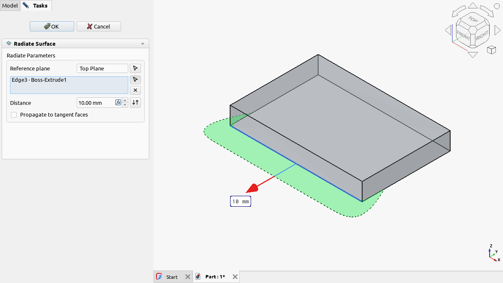

<!-- Generated by docs/build.py from docs/_data/catalog.json, docs/_authored/tools/radiate-surface.md, docs/_data/panels.json. Do not edit this file: change its sources and run `pixi run docs`. -->

# Radiate Surface

{ .tool-icon }
A surface spreading outward from edges, parallel to a plane (a parting surface).
{ .tool-lead }

Radiate Surface spreads a surface outward from edges, parallel to a plane: a parting surface for a mould.

## How to use it

1. Select the edges and click **Radiate Surface**.
2. Click the **Reference plane** the surface lies parallel to.
3. Set the **Distance** (or drag the arrow), then click **OK**.

## Where to find it

- The **Surfaces** toolbar, in the **More Surfaces** drop-down.
- **Solid Design** → **Surfaces** → **Radiate Surface**
- **Insert** → **Surface** → **Radiate Surface**
- Command search: press <kbd>/</kbd> in the 3D view and type its name.
- The command line: <kbd>:</kbd> then `radiatesurface` ([below](#on-the-command-line)).

## The panel

Every control's tooltip says the same as here: hover over it in FreeCAD. **OK** (or <kbd>Enter</kbd>) makes the feature, **Cancel** (or <kbd>Esc</kbd>) leaves the model as it was.

### Radiate Parameters

| Control | Kind | What it does |
| :-- | :-- | :-- |
| **Reference plane** | Selection box: click a plane or flat face | The surface lies parallel to this plane |
| **Edges** | Selection list: click edges | The edges to radiate from |
| **Distance** | A length | How far it reaches *(a flip button beside it)* |
| **Propagate to tangent faces** | A check box | Carry on along the edges meeting the picked ones smoothly |

## Drag handles

While the panel is open, drag the handles in the 3D view to set **Distance**, or click a handle's value and type. The same handles show when you select the feature in the tree, so you can change it without opening the panel. See [drag handles](../../guides/drag-handles.md).

## On the command line

Press <kbd>:</kbd> in the 3D view and type `radiatesurface`, then what to set. See [the command line](../../guides/keyboard.md) for how it works.

Values typed straight after the name set, in order: **Distance**. For example `:radiatesurface 10`.

??? note "Options it takes"

    | Option | How to type it | What it is |
    | :-- | :-- | :-- |
    | `Distance` | `distance=`a value | How far it reaches |
    | `Reverse` | `reverse` turns it on, `reverse=no` off | Towards the faces instead |
    | `PropagateTangent` | `propagatetangent` turns it on, `propagatetangent=no` off | Carry on along the edges meeting the picked ones smoothly |

## Properties

??? info "All properties"

    What the feature stores, as the **Property** editor shows it (select the feature in the tree, then the **Data** tab). The panel sets these for you.

    | Property | Kind | Default | What it is |
    | :-- | :-- | :-- | :-- |
    | `ReferencePlane` | Picks | – | The plane the surface lies parallel to |
    | `Items` | Picks | – | Edges to radiate from |
    | `Distance` | Length | 10 mm | How far it reaches |
    | `Reverse` | Yes/No | No | Towards the faces instead |
    | `PropagateTangent` | Yes/No | No | Carry on along the edges meeting the picked ones smoothly |

