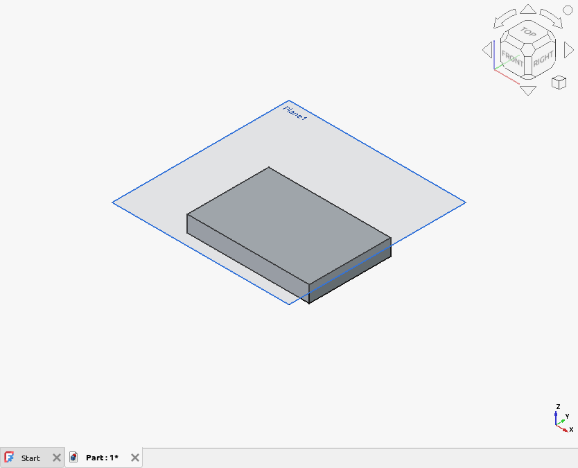

<!-- Generated by docs/build.py from docs/_data/catalog.json, docs/_authored/tools/reference-names.md. Do not edit this file: change its sources and run `pixi run docs`. -->

# Reference Names

{ .tool-icon }
Shows the names of planes, axes, points and coordinate systems in the 3D view.
{ .tool-lead }

Reference Names shows the names of planes, axes, points and coordinate systems in the 3D view: a plane's name lies flat in its top left corner, an axis's runs along it near one end, a point's sits just above it. The names stay the same size on screen as you zoom.

## How to use it

1. Click **Reference Names** in the **Solid Design** menu to turn the names on or off.

## Where to find it

- **Solid Design** → **Reference Names**
- Command search: press <kbd>/</kbd> in the 3D view and type its name.

