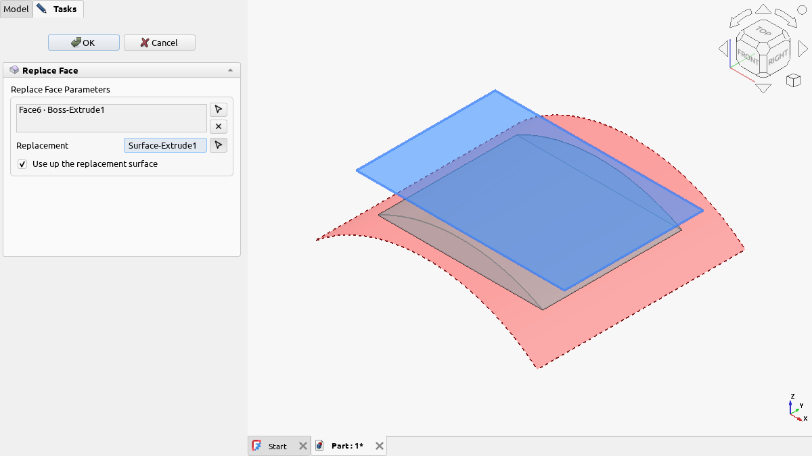

<!-- Generated by docs/build.py from docs/_data/catalog.json, docs/_authored/tools/replace-face.md, docs/_data/panels.json. Do not edit this file: change its sources and run `pixi run docs`. -->

# Replace Face

{ .tool-icon }
Replaces faces of a solid with a surface: the solid grows out to it or is trimmed back.
{ .tool-lead }

Replace Face swaps faces of a solid for a surface: the solid grows out to the surface or is trimmed back to it.

## How to use it

1. Make the replacement surface, reaching past the edges of the faces it replaces.
2. Select the faces to replace and click **Replace Face**.
3. Click the surface into **Replacement**.
4. Click **OK**.

## Where to find it

- The **Bodies** toolbar.
- **Solid Design** → **Bodies** → **Replace Face**
- **Insert** → **Features** → **Replace Face**
- Command search: press <kbd>/</kbd> in the 3D view and type its name.
- The command line: <kbd>:</kbd> then `replaceface` ([below](#on-the-command-line)).

## The panel

Every control's tooltip says the same as here: hover over it in FreeCAD. **OK** (or <kbd>Enter</kbd>) makes the feature, **Cancel** (or <kbd>Esc</kbd>) leaves the model as it was.

### Replace Face Parameters

| Control | Kind | What it does |
| :-- | :-- | :-- |
| **Faces** | Selection list: click faces | The faces to replace |
| **Replacement** | Selection box: click a body | The surface that replaces them |
| **Use up the replacement surface** | A check box | Hide it in the result, as SolidWorks does |

## On the command line

Press <kbd>:</kbd> in the 3D view and type `replaceface`, then what to set. See [the command line](../../guides/keyboard.md) for how it works.

??? note "Options it takes"

    | Option | How to type it | What it is |
    | :-- | :-- | :-- |
    | `ConsumeSurface` | `consumesurface` turns it on, `consumesurface=no` off | Use up the replacement surface |

## Properties

??? info "All properties"

    What the feature stores, as the **Property** editor shows it (select the feature in the tree, then the **Data** tab). The panel sets these for you.

    | Property | Kind | Default | What it is |
    | :-- | :-- | :-- | :-- |
    | `Items` | Picks | – | Faces to replace |
    | `ReplacementBody` | Text |  | The replacement surface body, by ID |
    | `ConsumeSurface` | Yes/No | Yes | Use up the replacement surface |

