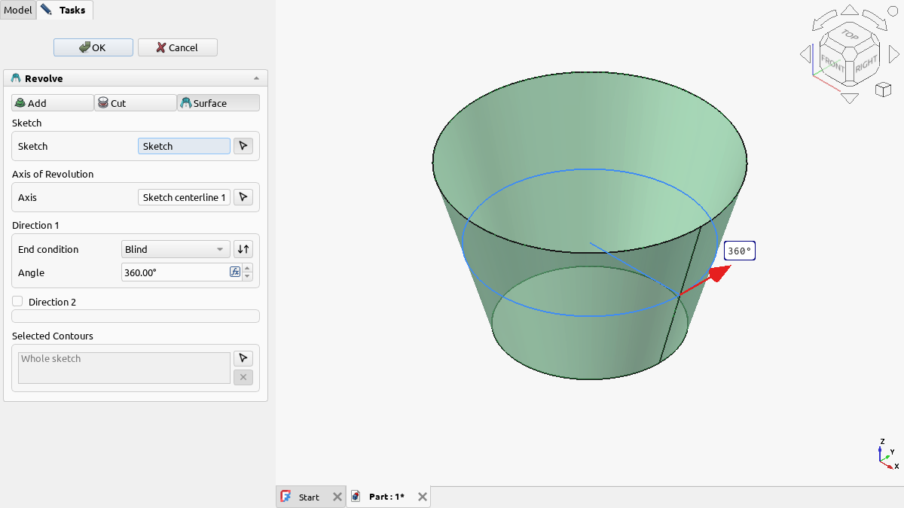

<!-- Generated by docs/build.py from docs/_data/catalog.json, docs/_authored/tools/revolved-surface.md, docs/_data/panels.json. Do not edit this file: change its sources and run `pixi run docs`. -->

# Revolved Surface

{ .tool-icon }
Revolves a sketch's curves around an axis into a surface body. Surface in the feature's Add | Cut | Surface switch.
{ .tool-lead }

Revolved Surface turns a sketch's curves round an axis into a surface body. It is [Revolve](revolve.md) with **Surface** pressed.

## How to use it

1. Sketch the profile and its centreline (or pick an axis).
2. Select the sketch and click **Revolved Surface**.
3. Set the **Angle**, then click **OK**.

## Where to find it

- The **Surfaces** toolbar.
- **Solid Design** → **Surfaces** → **Revolved Surface**
- **Insert** → **Surface** → **Revolved Surface**
- Command search: press <kbd>/</kbd> in the 3D view and type its name.
- The command line: <kbd>:</kbd> then `revolvedsurface` ([below](#on-the-command-line)).

## The panel

Every control's tooltip says the same as here: hover over it in FreeCAD. **OK** (or <kbd>Enter</kbd>) makes the feature, **Cancel** (or <kbd>Esc</kbd>) leaves the model as it was.

| Control | Kind | What it does |
| :-- | :-- | :-- |
| **Add \\| Cut \\| Surface** | Buttons: *Add* \\| *Cut* \\| *Surface* |  |

### Sketch

| Control | Kind | What it does |
| :-- | :-- | :-- |
| **Sketch** | Selection box: click a sketch | The sketch to use. Press the button, then click a sketch in the 3D view or tree. |

### Axis of Revolution

| Control | Kind | What it does |
| :-- | :-- | :-- |
| **Axis** | Selection box: click a line or axis | The axis the sketch turns about: a centerline or line of the sketch, an axis, a straight edge, or a round face or circular edge (its axis) |

### Direction 1

| Control | Kind | What it does |
| :-- | :-- | :-- |
| **End condition** | One of: *Blind*, *Up To Vertex*, *Up To Surface*, *Offset From Surface*, *Mid-Plane* | How far the revolve turns: an angle, up to a face or vertex, or both ways from the sketch (Mid Plane) *(a flip button beside it)* |
| **Angle** | An angle | How far the sketch turns |
| **Face** | Selection box: click a face or plane | The face or plane the revolve ends at *(shown for some choices only)* |
| **Vertex** | Selection box: click a vertex or point | The vertex or point the revolve ends at *(shown for some choices only)* |
| **Offset** | A length | Distance from the face to the end of the revolve *(a flip button beside it; shown for some choices only)* |
| **Merge result** | A check box | Fuse the new material with the bodies it touches. Off: it becomes a body of its own. *(shown for some choices only)* |
| **Flip side to cut** | A check box | Remove the material outside the profile instead of inside it *(shown for some choices only)* |

### Direction 2

Revolve the other way from the sketch too

*Optional: tick its title to use it.*

| Control | Kind | What it does |
| :-- | :-- | :-- |
| **End condition** | One of: *Blind*, *Up To Vertex*, *Up To Surface*, *Offset From Surface* | How far the revolve turns: an angle, up to a face or vertex, or both ways from the sketch (Mid Plane) the other way *(shown for some choices only)* |
| **Angle** | An angle | How far the sketch turns the other way *(shown for some choices only)* |
| **Face** | Selection box: click a face or plane | The face or plane the revolve ends at *(shown for some choices only)* |
| **Vertex** | Selection box: click a vertex or point | The vertex or point the revolve ends at *(shown for some choices only)* |
| **Offset** | A length | Distance from the face to the end of the revolve *(a flip button beside it; shown for some choices only)* |

### Thin Feature

Make a wall of constant thickness from the sketch's curves instead of filling it

*Optional: tick its title to use it. Shown only for some choices above.*

| Control | Kind | What it does |
| :-- | :-- | :-- |
| **Type** | One of: *One-Direction*, *Mid-Plane*, *Two-Direction* | Which side of the curves the wall grows on *(a flip button beside it; shown for some choices only)* |
| **Thickness** | A length | Wall thickness *(shown for some choices only)* |
| **Thickness 2** | A length | Wall thickness on the second side *(shown for some choices only)* |

### Selected Contours

| Control | Kind | What it does |
| :-- | :-- | :-- |
| **Regions** | Selection list: click inside regions of the sketch | Use only some regions of the sketch: click inside them in the 3D view. Empty: the whole sketch. |

### Feature Scope

Which bodies the feature works on

*Shown only for some choices above.*

| Control | Kind | What it does |
| :-- | :-- | :-- |
| **All bodies \\| Selected bodies** | Buttons: *All bodies* \\| *Selected bodies* |  |
| **Auto-select** | A check box | Use the bodies the feature touches; untick to choose them *(shown for some choices only)* |
| **Bodies** | Selection list: click bodies in the 3D view or tree | The bodies the feature works on *(shown for some choices only)* |

### Bodies to Keep

The cut splits a body: choose which pieces to keep

*Shown only for some choices above.*

| Control | Kind | What it does |
| :-- | :-- | :-- |
| **All bodies \\| Selected bodies** | Buttons: *All bodies* \\| *Selected bodies* |  |
|  | A list | Tick the pieces to keep. They are numbered in the 3D view. |

## Drag handles

While the panel is open, drag the handles in the 3D view to set **Angle**, or click a handle's value and type. The same handles show when you select the feature in the tree, so you can change it without opening the panel. See [drag handles](../../guides/drag-handles.md).

## On the command line

Press <kbd>:</kbd> in the 3D view and type `revolvedsurface`, then what to set. See [the command line](../../guides/keyboard.md) for how it works.

Values typed straight after the name set, in order: **Angle**, **Angle2**. For example `:revolvedsurface 360 30`.

??? note "Options it takes"

    | Option | How to type it | What it is |
    | :-- | :-- | :-- |
    | `Mode` | a word: `add`, `cut`, `surface` | Add material, cut it, or make a surface body |
    | `Thin` | `thin` turns it on, `thin=no` off | Thin Feature on/off |
    | `ThinType` | a word: `onedirection`, `midplane`, `twodirection` | Thin type |
    | `ThinThickness` | `thinthickness=`a value | Thickness |
    | `ThinThickness2` | `thinthickness2=`a value | Thickness 2 (Two-Direction) |
    | `ThinReverse` | `thinreverse` turns it on, `thinreverse=no` off | Reverse the thin direction |
    | `MergeResult` | `mergeresult` turns it on, `mergeresult=no` off | Merge result (Add mode) |
    | `FeatureScope` | a word: `allbodies`, `selectedbodies` | Feature scope |
    | `AutoSelect` | `autoselect` turns it on, `autoselect=no` off | Auto-select the bodies in scope |
    | `BodiesToKeep` | a word: `allbodies`, `selectedbodies` | Bodies to Keep |
    | `FlipSideToCut` | `flipsidetocut` turns it on, `flipsidetocut=no` off | Flip side to cut (Cut mode) |
    | `Reverse` | `reverse` turns it on, `reverse=no` off | Reverse Direction |
    | `EndCondition` | a word: `blind`, `uptovertex`, `uptosurface`, `offsetfromsurface`, `midplane` | End condition |
    | `Angle` | `angle=`a value | Angle |
    | `Offset` | `offset=`a value | Offset From Surface distance |
    | `ReverseOffset` | `reverseoffset` turns it on, `reverseoffset=no` off | Reverse offset |
    | `Direction2` | `direction2` turns it on, `direction2=no` off | Revolve the other way too |
    | `EndCondition2` | a word: `blind`, `uptovertex`, `uptosurface`, `offsetfromsurface` | End condition |
    | `Angle2` | `angle2=`a value | Angle |
    | `Offset2` | `offset2=`a value | Offset From Surface distance |
    | `ReverseOffset2` | `reverseoffset2` turns it on, `reverseoffset2=no` off | Reverse offset |

## Properties

??? info "All properties"

    What the feature stores, as the **Property** editor shows it (select the feature in the tree, then the **Data** tab). The panel sets these for you.

    | Property | Kind | Default | What it is |
    | :-- | :-- | :-- | :-- |
    | `Mode` | Choice | Add | Add material, cut it, or make a surface body Choices: *Add*, *Cut*, *Surface*. |
    | `Sketch` | Object | – | The profile sketch |
    | `Contours` | List | – | Selected Contours: regions of the sketch (bounding geometry IDs + a point inside) |
    | `Thin` | Yes/No | No | Thin Feature on/off |
    | `ThinType` | Choice | One-Direction | Thin type Choices: *One-Direction*, *Mid-Plane*, *Two-Direction*. |
    | `ThinThickness` | Length | 1 mm | Thickness |
    | `ThinThickness2` | Length | 1 mm | Thickness 2 (Two-Direction) |
    | `ThinReverse` | Yes/No | No | Reverse the thin direction |
    | `MergeResult` | Yes/No | Yes | Merge result (Add mode) |
    | `FeatureScope` | Choice | All bodies | Feature scope Choices: *All bodies*, *Selected bodies*. |
    | `AutoSelect` | Yes/No | Yes | Auto-select the bodies in scope |
    | `ScopeBodies` | List | – | Body IDs in scope |
    | `BodiesToKeep` | Choice | All bodies | Bodies to Keep Choices: *All bodies*, *Selected bodies*. |
    | `KeepBodies` | List | – | Piece IDs to keep |
    | `FlipSideToCut` | Yes/No | No | Flip side to cut (Cut mode) |
    | `Axis` | Picks | – | Axis of revolution |
    | `Reverse` | Yes/No | No | Reverse Direction |
    | `EndCondition` | Choice | Blind | End condition Choices: *Blind*, *Up To Vertex*, *Up To Surface*, *Offset From Surface*, *Mid-Plane*. |
    | `Angle` | Angle | 360° | Angle |
    | `UpToFace` | Picks | – | Face or plane to revolve up to |
    | `UpToVertex` | Picks | – | Vertex to revolve up to |
    | `Offset` | Length | 0 mm | Offset From Surface distance |
    | `ReverseOffset` | Yes/No | No | Reverse offset |
    | `Direction2` | Yes/No | No | Revolve the other way too |
    | `EndCondition2` | Choice | Blind | End condition Choices: *Blind*, *Up To Vertex*, *Up To Surface*, *Offset From Surface*. |
    | `Angle2` | Angle | 30° | Angle |
    | `UpToFace2` | Picks | – | Face or plane to revolve up to |
    | `UpToVertex2` | Picks | – | Vertex to revolve up to |
    | `Offset2` | Length | 0 mm | Offset From Surface distance |
    | `ReverseOffset2` | Yes/No | No | Reverse offset |

