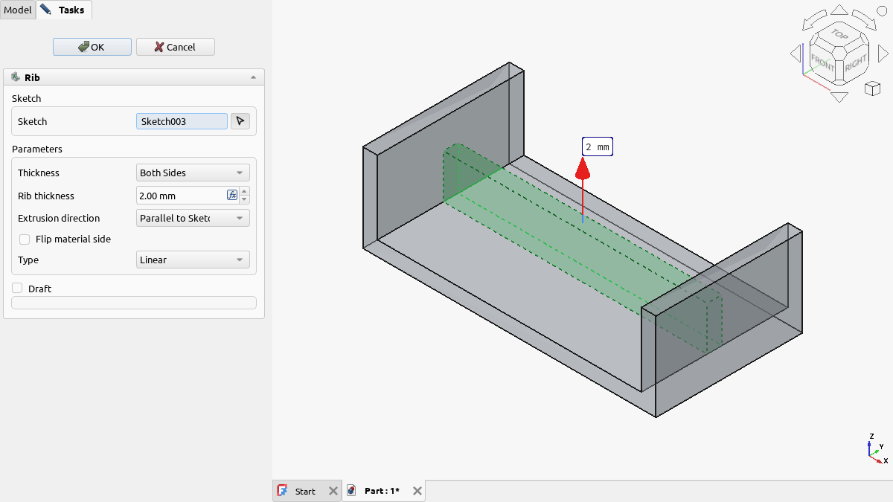

<!-- Generated by docs/build.py from docs/_data/catalog.json, docs/_authored/tools/rib.md, docs/_data/panels.json. Do not edit this file: change its sources and run `pixi run docs`. -->

# Rib

{ .tool-icon }
Grows a wall of material from open sketch lines until it meets the model: in the sketch plane, or out of it.
{ .tool-lead }

Rib grows a wall from open sketch lines until it meets the model: stiffening ribs in a channel, gussets under a ledge. The line doesn't have to touch the walls; the rib runs on until it reaches them.

## How to use it

1. Draw the rib's line in a sketch.
2. Select the sketch and click **Rib**.
3. Choose the **Extrusion direction**: **Parallel to Sketch** (the rib lies in the sketch plane, from the line out to the model) or **Normal to Sketch** (it grows out of the sketch plane to the model).
4. Set the **Rib thickness**, and under **Thickness** whether it is centred on the line (**Both Sides**) or to one side. **Flip material side** grows it the other way.
5. Click **OK**.

## Good to know

- **Draft** tapers the rib for moulding.
- **Type** says how the line's ends reach the model: **Linear** carries on along them, **Natural** carries arcs on round their circles.

## Where to find it

- The **Features** toolbar.
- **Solid Design** → **Features** → **Rib**
- **Insert** → **Features** → **Rib**
- Command search: press <kbd>/</kbd> in the 3D view and type its name.
- The command line: <kbd>:</kbd> then `rib` ([below](#on-the-command-line)).

## The panel

Every control's tooltip says the same as here: hover over it in FreeCAD. **OK** (or <kbd>Enter</kbd>) makes the feature, **Cancel** (or <kbd>Esc</kbd>) leaves the model as it was.

### Sketch

| Control | Kind | What it does |
| :-- | :-- | :-- |
| **Sketch** | Selection box: click a sketch | The open sketch lines the rib is made from |

### Parameters

| Control | Kind | What it does |
| :-- | :-- | :-- |
| **Thickness** | One of: *First Side*, *Both Sides*, *Second Side* | First Side or Second Side: the thickness goes to one side of the sketch line. Both Sides: centred on it. |
| **Rib thickness** | A length | How thick the rib is |
| **Extrusion direction** | One of: *Parallel to Sketch*, *Normal to Sketch* | Parallel to Sketch: the rib lies in the sketch plane, from the line to the model. Normal to Sketch: it grows out of the sketch plane to the model. |
| **Flip material side** | A check box | Grow the rib to the other side of the sketch line |
| **Type** | One of: *Linear*, *Natural* | How the ends reach the model. Linear: along their tangents. Natural: arcs carry on round their circles. |

### Draft

Lean the rib's sides

*Optional: tick its title to use it.*

| Control | Kind | What it does |
| :-- | :-- | :-- |
| **Angle** | An angle | Draft angle *(shown for some choices only)* |
| **Draft outward** | A check box | Thicker towards the model; off: thinner *(shown for some choices only)* |

## Drag handles

While the panel is open, drag the handles in the 3D view to set **Thickness**, or click a handle's value and type. The same handles show when you select the feature in the tree, so you can change it without opening the panel. See [drag handles](../../guides/drag-handles.md).

## On the command line

Press <kbd>:</kbd> in the 3D view and type `rib`, then what to set. See [the command line](../../guides/keyboard.md) for how it works.

Values typed straight after the name set, in order: **Thickness**. For example `:rib 2`.

??? note "Options it takes"

    | Option | How to type it | What it is |
    | :-- | :-- | :-- |
    | `Thickness` | `thickness=`a value | Rib thickness |
    | `ThicknessSide` | a word: `firstside`, `bothsides`, `secondside` | Which side of the sketch line the thickness goes |
    | `ExtrusionDirection` | a word: `paralleltosketch`, `normaltosketch` | Parallel to Sketch: the rib lies in the sketch plane. Normal to Sketch: it grows out of the plane. |
    | `FlipMaterialSide` | `flipmaterialside` turns it on, `flipmaterialside=no` off | Grow the rib to the other side of the sketch line |
    | `ExtendType` | a word: `linear`, `natural` | How the ends reach the model: Linear (along their tangents) or Natural (arcs carry on round their circles) |
    | `Draft` | `draft` turns it on, `draft=no` off | Lean the rib's sides |
    | `DraftAngle` | `draftangle=`a value | Draft angle |
    | `DraftOutward` | `draftoutward` turns it on, `draftoutward=no` off | Thicker towards the model (off: thinner) |

## Properties

??? info "All properties"

    What the feature stores, as the **Property** editor shows it (select the feature in the tree, then the **Data** tab). The panel sets these for you.

    | Property | Kind | Default | What it is |
    | :-- | :-- | :-- | :-- |
    | `Sketch` | Object | – | The rib's sketch (open lines) |
    | `Thickness` | Length | 2 mm | Rib thickness |
    | `ThicknessSide` | Choice | First Side | Which side of the sketch line the thickness goes Choices: *First Side*, *Both Sides*, *Second Side*. |
    | `ExtrusionDirection` | Choice | Parallel to Sketch | Parallel to Sketch: the rib lies in the sketch plane. Normal to Sketch: it grows out of the plane. Choices: *Parallel to Sketch*, *Normal to Sketch*. |
    | `FlipMaterialSide` | Yes/No | No | Grow the rib to the other side of the sketch line |
    | `ExtendType` | Choice | Linear | How the ends reach the model: Linear (along their tangents) or Natural (arcs carry on round their circles) Choices: *Linear*, *Natural*. |
    | `Draft` | Yes/No | No | Lean the rib's sides |
    | `DraftAngle` | Angle | 1° | Draft angle |
    | `DraftOutward` | Yes/No | No | Thicker towards the model (off: thinner) |

