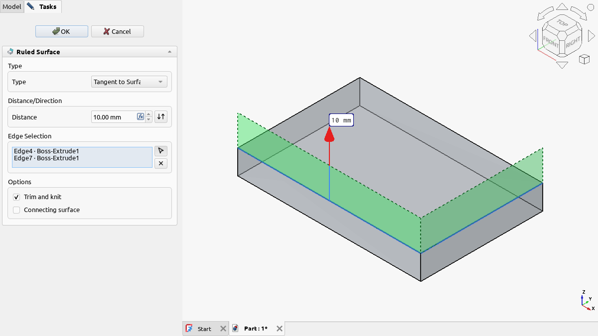

<!-- Generated by docs/build.py from docs/_data/catalog.json, docs/_authored/tools/ruled-surface.md, docs/_data/panels.json. Do not edit this file: change its sources and run `pixi run docs`. -->

# Ruled Surface

{ .tool-icon }
Strips standing off edges: tangent or normal to the faces, or at an angle to a direction.
{ .tool-lead }

Ruled Surface stands a strip off edges: tangent to the faces, normal to them, or at an angle to a direction. Use it for parting surfaces, flanges and shut-offs.

## How to use it

1. Select the edges and click **Ruled Surface**.
2. Choose the **Type**: **Tangent to Surface**, **Normal to Surface**, **Tapered to Vector**, **Perpendicular to Vector** or **Sweep**. Set the **Distance** (or drag the arrow).
3. Click **OK**.

## Where to find it

- The **Surfaces** toolbar, in the **More Surfaces** drop-down.
- **Solid Design** → **Surfaces** → **Ruled Surface**
- **Insert** → **Surface** → **Ruled Surface**
- Command search: press <kbd>/</kbd> in the 3D view and type its name.
- The command line: <kbd>:</kbd> then `ruledsurface` ([below](#on-the-command-line)).

## The panel

Every control's tooltip says the same as here: hover over it in FreeCAD. **OK** (or <kbd>Enter</kbd>) makes the feature, **Cancel** (or <kbd>Esc</kbd>) leaves the model as it was.

### Type

| Control | Kind | What it does |
| :-- | :-- | :-- |
| **Type** | One of: *Tangent to Surface*, *Normal to Surface*, *Tapered to Vector*, *Perpendicular to Vector*, *Sweep* | Tangent to Surface: carries on from the face beside the edge. Normal to Surface: stands square off it. Tapered / Perpendicular to Vector: at an angle to, or square to, a direction you pick. Sweep: one smooth surface swept along the edges, leaving the first at the face's tangent (or the vector). |

### Distance/Direction

| Control | Kind | What it does |
| :-- | :-- | :-- |
| **Distance** | A length | How far the strips reach *(a flip button beside it)* |
| **Reference vector** | Selection box: click an edge or plane | The direction to taper to, or stand square to: an edge or axis, or a plane's normal *(shown for some choices only)* |
| **Angle** | An angle | The angle to the vector *(shown for some choices only)* |

### Edge Selection

| Control | Kind | What it does |
| :-- | :-- | :-- |
| **Edges** | Selection list: click edges | The edges the strips stand off |

### Options

| Control | Kind | What it does |
| :-- | :-- | :-- |
| **Trim and knit** | A check box | Cut the strips back where they cross at corners, and knit them into one surface |
| **Connecting surface** | A check box | Fill the gaps between strips at sharp corners |

## Drag handles

While the panel is open, drag the handles in the 3D view to set **Distance**, or click a handle's value and type. The same handles show when you select the feature in the tree, so you can change it without opening the panel. See [drag handles](../../guides/drag-handles.md).

## On the command line

Press <kbd>:</kbd> in the 3D view and type `ruledsurface`, then what to set. See [the command line](../../guides/keyboard.md) for how it works.

Values typed straight after the name set, in order: **Distance**. For example `:ruledsurface 10`.

??? note "Options it takes"

    | Option | How to type it | What it is |
    | :-- | :-- | :-- |
    | `RuledType` | a word: `tangenttosurface`, `normaltosurface`, `taperedtovector`, `perpendiculartovector`, `sweep` | How the strips stand off the edges |
    | `Distance` | `distance=`a value | How far the strips reach |
    | `Angle` | `angle=`a value | Tapered to Vector: the angle |
    | `AlternateSide` | `alternateside` turns it on, `alternateside=no` off | The other side |
    | `TrimAndKnit` | `trimandknit` turns it on, `trimandknit=no` off | Several edges: cut the strips back where they cross at corners, and knit them |
    | `ConnectingSurface` | `connectingsurface` turns it on, `connectingsurface=no` off | Several edges: fill the gaps between strips at sharp corners |

## Properties

??? info "All properties"

    What the feature stores, as the **Property** editor shows it (select the feature in the tree, then the **Data** tab). The panel sets these for you.

    | Property | Kind | Default | What it is |
    | :-- | :-- | :-- | :-- |
    | `RuledType` | Choice | Tangent to Surface | How the strips stand off the edges Choices: *Tangent to Surface*, *Normal to Surface*, *Tapered to Vector*, *Perpendicular to Vector*, *Sweep*. |
    | `Items` | Picks | – | Edges to rule from |
    | `Distance` | Length | 10 mm | How far the strips reach |
    | `ReferenceVector` | Picks | – | Tapered / Perpendicular to Vector: an edge, axis or plane (its normal) |
    | `Angle` | Angle | 10° | Tapered to Vector: the angle |
    | `AlternateSide` | Yes/No | No | The other side |
    | `TrimAndKnit` | Yes/No | Yes | Several edges: cut the strips back where they cross at corners, and knit them |
    | `ConnectingSurface` | Yes/No | No | Several edges: fill the gaps between strips at sharp corners |

