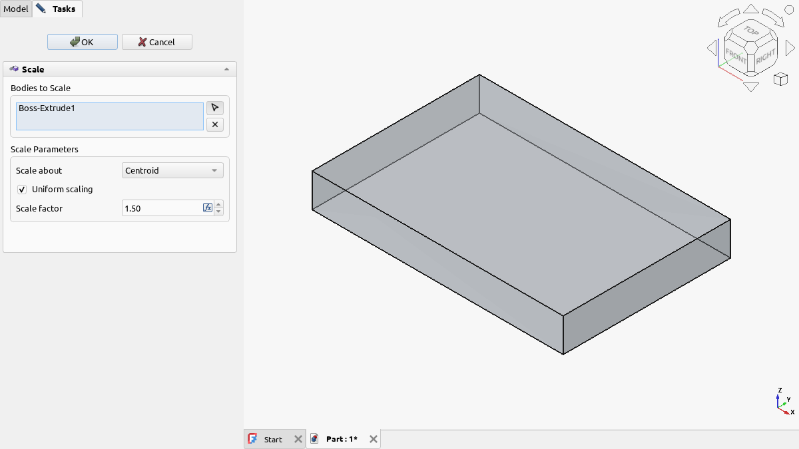

<!-- Generated by docs/build.py from docs/_data/catalog.json, docs/_authored/tools/scale.md, docs/_data/panels.json. Do not edit this file: change its sources and run `pixi run docs`. -->

# Scale

{ .tool-icon }
Scales bodies about their centre, the origin or a coordinate system.
{ .tool-lead }

Scale makes bodies bigger or smaller.

## How to use it

1. Select the bodies and click **Scale**.
2. Choose what to **Scale about**: the body's centroid, the origin, or a coordinate system.
3. Set the **Scale factor**, or untick **Uniform scaling** for a factor per direction.
4. Click **OK**.

## Where to find it

- The **Bodies** toolbar, in the **Deform Bodies** drop-down.
- **Solid Design** → **Bodies** → **Scale**
- **Insert** → **Features** → **Scale**
- Command search: press <kbd>/</kbd> in the 3D view and type its name.
- The command line: <kbd>:</kbd> then `scale` ([below](#on-the-command-line)).

## The panel

Every control's tooltip says the same as here: hover over it in FreeCAD. **OK** (or <kbd>Enter</kbd>) makes the feature, **Cancel** (or <kbd>Esc</kbd>) leaves the model as it was.

### Bodies to Scale

| Control | Kind | What it does |
| :-- | :-- | :-- |
| **Bodies** | Selection list: click bodies in the 3D view or tree | The bodies to scale (none picked: every solid) |

### Scale Parameters

| Control | Kind | What it does |
| :-- | :-- | :-- |
| **Scale about** | One of: *Centroid*, *Origin*, *Coordinate System* | Centroid: each body's centre. Origin: the part's origin. Coordinate System: one you pick. |
| **Coordinate system** | Selection box: click a coordinate system | The coordinate system to scale about *(shown for some choices only)* |
| **Uniform scaling** | A check box | The same factor every way (keeps every surface's kind) |
| **Scale factor** | A number | How many times bigger |
| **X** | A number | Factor along X *(shown for some choices only)* |
| **Y** | A number | Factor along Y *(shown for some choices only)* |
| **Z** | A number | Factor along Z *(shown for some choices only)* |

## On the command line

Press <kbd>:</kbd> in the 3D view and type `scale`, then what to set. See [the command line](../../guides/keyboard.md) for how it works.

??? note "Options it takes"

    | Option | How to type it | What it is |
    | :-- | :-- | :-- |
    | `ScaleAbout` | a word: `centroid`, `origin`, `coordinatesystem` | The point it scales about |
    | `Uniform` | `uniform` turns it on, `uniform=no` off | The same factor every way |
    | `Factor` | `factor=`a value | Scale factor |
    | `FactorX` | `factorx=`a value | Scale factor along X |
    | `FactorY` | `factory=`a value | Scale factor along Y |
    | `FactorZ` | `factorz=`a value | Scale factor along Z |

## Properties

??? info "All properties"

    What the feature stores, as the **Property** editor shows it (select the feature in the tree, then the **Data** tab). The panel sets these for you.

    | Property | Kind | Default | What it is |
    | :-- | :-- | :-- | :-- |
    | `Bodies` | List | – | Bodies to scale (empty: all solids) |
    | `ScaleAbout` | Choice | Centroid | The point it scales about Choices: *Centroid*, *Origin*, *Coordinate System*. |
    | `CoordinateSystem` | Object | – | Scale about this coordinate system |
    | `Uniform` | Yes/No | Yes | The same factor every way |
    | `Factor` | Number | 1 | Scale factor |
    | `FactorX` | Number | 1 | Scale factor along X |
    | `FactorY` | Number | 1 | Scale factor along Y |
    | `FactorZ` | Number | 1 | Scale factor along Z |

