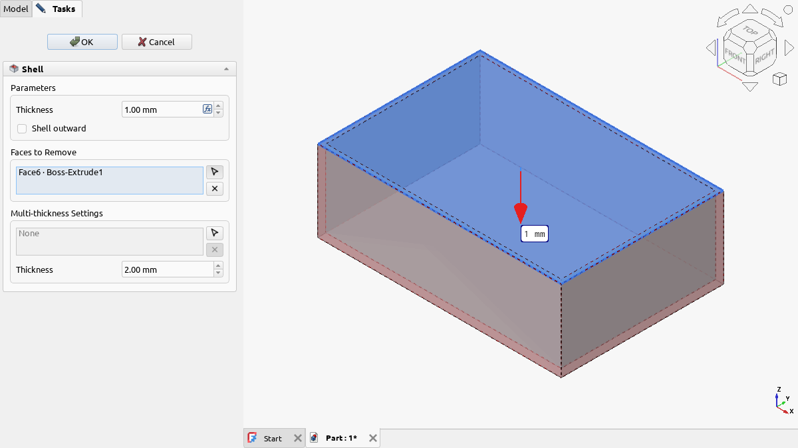

<!-- Generated by docs/build.py from docs/_data/catalog.json, docs/_authored/tools/shell.md, docs/_data/panels.json. Do not edit this file: change its sources and run `pixi run docs`. -->

# Shell

{ .tool-icon }
Hollows a body, leaving open the faces you pick, with walls of the given thickness.
{ .tool-lead }

Shell hollows a solid, leaving the faces you pick open: boxes, cases, cups.

## How to use it

1. Select the faces to remove (the open side). With none, the body is hollowed with no opening.
2. Click **Shell**.
3. Set the wall **Thickness**, or drag the handle. **Shell outward** puts the walls outside the original shape.
4. Click **OK**.

## Good to know

- **Multi-thickness Settings** gives chosen faces their own wall thickness.

## Where to find it

- The **Features** toolbar.
- **Solid Design** → **Features** → **Shell**
- **Insert** → **Features** → **Shell**
- Command search: press <kbd>/</kbd> in the 3D view and type its name.
- The command line: <kbd>:</kbd> then `shell` ([below](#on-the-command-line)).

## The panel

Every control's tooltip says the same as here: hover over it in FreeCAD. **OK** (or <kbd>Enter</kbd>) makes the feature, **Cancel** (or <kbd>Esc</kbd>) leaves the model as it was.

### Parameters

| Control | Kind | What it does |
| :-- | :-- | :-- |
| **Thickness** | A length | Wall thickness |
| **Shell outward** | A check box | Grow the walls outwards, keeping the inside the same size |

### Faces to Remove

| Control | Kind | What it does |
| :-- | :-- | :-- |
| **Faces** | Selection list: click faces to remove | The faces to remove, opening the shell. Empty: hollow the body inside. |

### Multi-thickness Settings

Faces whose walls have their own thickness, thicker or thinner than the shell

| Control | Kind | What it does |
| :-- | :-- | :-- |
| **Faces** | Selection list: click faces | Faces whose walls get their own thickness. Click a face in the list to see or change its thickness. |
| **Thickness** | A length | Wall thickness of the selected faces in the list (of all of them when none is selected); thicker or thinner than the shell |

## Drag handles

While the panel is open, drag the handles in the 3D view to set **Thickness**, or click a handle's value and type. The same handles show when you select the feature in the tree, so you can change it without opening the panel. See [drag handles](../../guides/drag-handles.md).

## On the command line

Press <kbd>:</kbd> in the 3D view and type `shell`, then what to set. See [the command line](../../guides/keyboard.md) for how it works.

Values typed straight after the name set, in order: **Thickness**. For example `:shell 1`.

??? note "Options it takes"

    | Option | How to type it | What it is |
    | :-- | :-- | :-- |
    | `Thickness` | `thickness=`a value | Wall thickness |
    | `ShellOutward` | `shelloutward` turns it on, `shelloutward=no` off | Shell outward |

## Properties

??? info "All properties"

    What the feature stores, as the **Property** editor shows it (select the feature in the tree, then the **Data** tab). The panel sets these for you.

    | Property | Kind | Default | What it is |
    | :-- | :-- | :-- | :-- |
    | `Thickness` | Length | 1 mm | Wall thickness |
    | `ShellOutward` | Yes/No | No | Shell outward |
    | `Items` | Picks | – | Faces to remove |
    | `Body` | Text |  | Body to hollow when no face is removed |
    | `MultiFaces` | Picks | – | Faces with their own thickness |
    | `MultiThickness` | FloatList | – | Thickness of each multi-thickness face (mm) |

