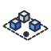
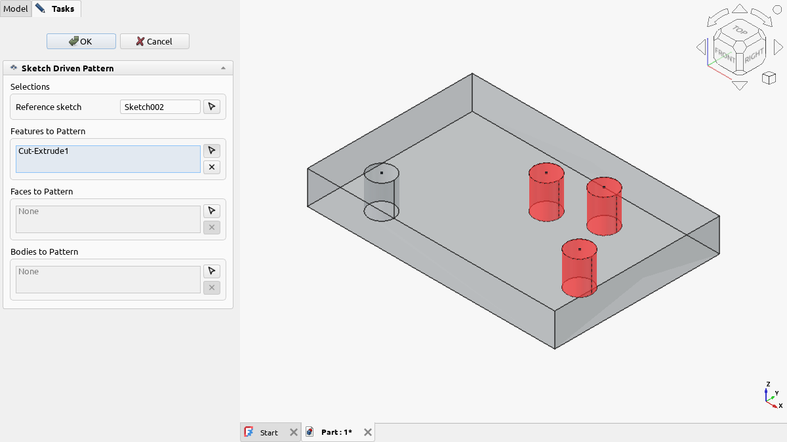

<!-- Generated by docs/build.py from docs/_data/catalog.json, docs/_authored/tools/sketch-driven-pattern.md, docs/_data/panels.json. Do not edit this file: change its sources and run `pixi run docs`. -->

# Sketch Driven Pattern

{ .tool-icon }
Repeats features or bodies at a sketch's points.
{ .tool-lead }

Sketch Driven Pattern puts a copy of features at each point of a sketch: holes at sketched positions that don't follow a grid.

## How to use it

1. Sketch points where the copies go.
2. Select the sketch and click **Sketch Driven Pattern**.
3. Click the features to repeat into **Features to Pattern**.
4. Click **OK**.

## Where to find it

- The **Features** toolbar, in the **Patterns** drop-down.
- **Solid Design** → **Patterns** → **Sketch Driven Pattern**
- **Insert** → **Pattern/Mirror** → **Sketch Driven Pattern**
- Command search: press <kbd>/</kbd> in the 3D view and type its name.
- The command line: <kbd>:</kbd> then `sketchdrivenpattern`.

## The panel

Every control's tooltip says the same as here: hover over it in FreeCAD. **OK** (or <kbd>Enter</kbd>) makes the feature, **Cancel** (or <kbd>Esc</kbd>) leaves the model as it was.

### Selections

| Control | Kind | What it does |
| :-- | :-- | :-- |
| **Reference sketch** | Selection box: click a sketch | The sketch whose points place the instances; the original's centre is the reference |

### Features to Pattern

| Control | Kind | What it does |
| :-- | :-- | :-- |
| **Features** | Selection list: click features in the tree, or their faces | The features to repeat: click them in the tree, or click a face they made |

### Faces to Pattern

| Control | Kind | What it does |
| :-- | :-- | :-- |
| **Faces** | Selection list: click faces | Every face of a boss, hole or pocket to repeat (its walls and top or floor). Material is added where they bound material, cut where they bound a gap. |

### Bodies to Pattern

| Control | Kind | What it does |
| :-- | :-- | :-- |
| **Bodies** | Selection list: click bodies in the 3D view or tree | Whole bodies to repeat |

## Properties

??? info "All properties"

    What the feature stores, as the **Property** editor shows it (select the feature in the tree, then the **Data** tab). The panel sets these for you.

    | Property | Kind | Default | What it is |
    | :-- | :-- | :-- | :-- |
    | `Features` | Objects | – | Features to repeat |
    | `Bodies` | List | – | Bodies to repeat, by ID |
    | `Faces` | Picks | – | Faces to repeat: every face of a boss, hole or pocket |
    | `Sketch` | Object | – | The sketch whose points place the instances |

