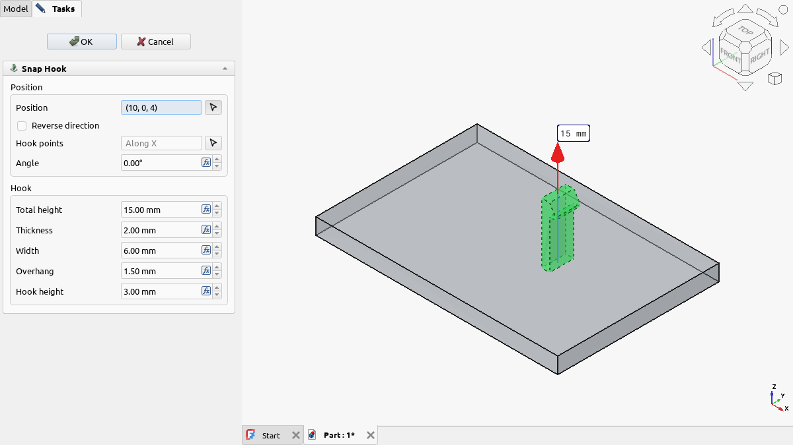

<!-- Generated by docs/build.py from docs/_data/catalog.json, docs/_authored/tools/snap-hook.md, docs/_data/panels.json. Do not edit this file: change its sources and run `pixi run docs`. -->

# Snap Hook

{ .tool-icon }
Adds a snap hook (a beam with a catch on its tip) on a face: click where it goes.
{ .tool-lead }

Snap Hook adds a cantilever snap fit: a beam with a catch on its tip.

## How to use it

1. Click **Snap Hook**.
2. Click on the face where it stands.
3. Turn it with **Angle**, or pick **Hook points** for its direction.
4. Set the **Hook** sizes: total height, thickness, width, how far the catch overhangs and its height.
5. Click **OK**.

## Where to find it

- The **Features** toolbar, in the **Fastening Features** drop-down.
- **Solid Design** → **Features** → **Snap Hook**
- Command search: press <kbd>/</kbd> in the 3D view and type its name.
- The command line: <kbd>:</kbd> then `snaphook` ([below](#on-the-command-line)).

## The panel

Every control's tooltip says the same as here: hover over it in FreeCAD. **OK** (or <kbd>Enter</kbd>) makes the feature, **Cancel** (or <kbd>Esc</kbd>) leaves the model as it was.

### Position

| Control | Kind | What it does |
| :-- | :-- | :-- |
| **Position** | Selection box: click on a face | Where the snap hook stands: click on a face |
| **Reverse direction** | A check box | Stand the other way off the face |
| **Hook points** | Selection box: click an edge or plane | The way the hook points: an edge, or a plane's normal. Empty: along X |
| **Angle** | An angle | Turns the hook about the face's normal |

### Hook

| Control | Kind | What it does |
| :-- | :-- | :-- |
| **Total height** | A length | Face to the hook's top |
| **Thickness** | A length | The beam's thickness, along the hook |
| **Width** | A length | The beam's width |
| **Overhang** | A length | How far the hook sticks out past the beam |
| **Hook height** | A length | From the catch face to the top |

## Drag handles

While the panel is open, drag the handles in the 3D view to set **Height**, or click a handle's value and type. The same handles show when you select the feature in the tree, so you can change it without opening the panel. See [drag handles](../../guides/drag-handles.md).

## On the command line

Press <kbd>:</kbd> in the 3D view and type `snaphook`, then what to set. See [the command line](../../guides/keyboard.md) for how it works.

Values typed straight after the name set, in order: **Height**. For example `:snaphook 15`.

??? note "Options it takes"

    | Option | How to type it | What it is |
    | :-- | :-- | :-- |
    | `ReverseDirection` | `reversedirection` turns it on, `reversedirection=no` off | Stand the other way off the face |
    | `HookAngle` | `hookangle=`a value | Turns the hook about the face's normal |
    | `Height` | `height=`a value | Total height, face to the hook's top |
    | `Thickness` | `thickness=`a value | Beam thickness (along the hook) |
    | `Width` | `width=`a value | Beam width |
    | `Overhang` | `overhang=`a value | How far the hook sticks out |
    | `LipHeight` | `lipheight=`a value | The hook's height, catch to top |

## Properties

??? info "All properties"

    What the feature stores, as the **Property** editor shows it (select the feature in the tree, then the **Data** tab). The panel sets these for you.

    | Property | Kind | Default | What it is |
    | :-- | :-- | :-- | :-- |
    | `Items` | Picks | – | The face it stands on |
    | `Position` | Text |  | Where on the face (x,y,z) |
    | `ReverseDirection` | Yes/No | No | Stand the other way off the face |
    | `HookDirection` | Picks | – | The way the hook points: an edge or plane (empty: along X) |
    | `HookAngle` | Angle | 0° | Turns the hook about the face's normal |
    | `Height` | Length | 15 mm | Total height, face to the hook's top |
    | `Thickness` | Length | 2 mm | Beam thickness (along the hook) |
    | `Width` | Length | 6 mm | Beam width |
    | `Overhang` | Length | 1.5 mm | How far the hook sticks out |
    | `LipHeight` | Length | 3 mm | The hook's height, catch to top |

