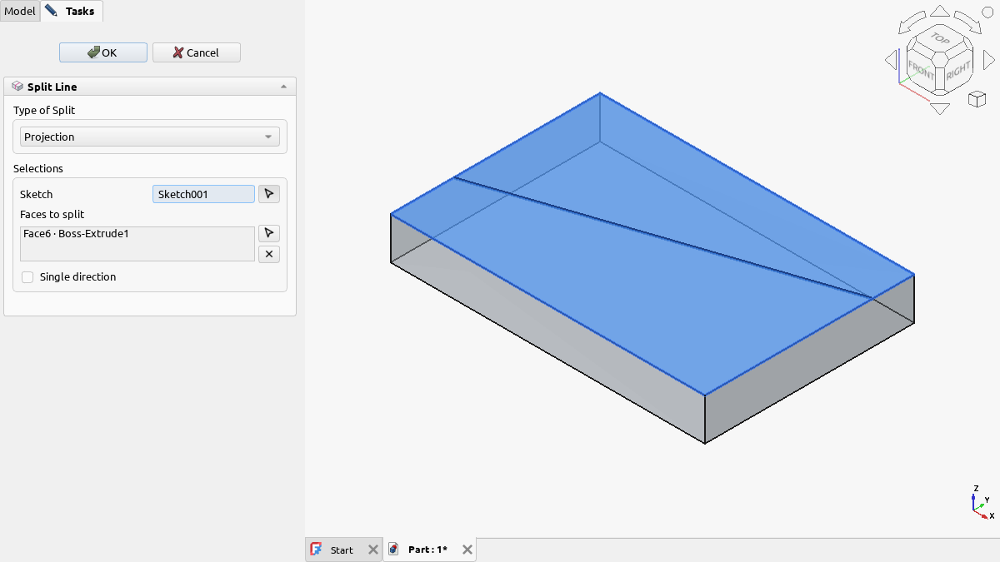

<!-- Generated by docs/build.py from docs/_data/catalog.json, docs/_authored/tools/split-line.md, docs/_data/panels.json. Do not edit this file: change its sources and run `pixi run docs`. -->

# Split Line

{ .tool-icon }
Splits faces into more faces, without changing the body: by a projected sketch, where planes cut them, or along their silhouette.
{ .tool-lead }

Split Line splits faces into more faces without changing the shape: to apply a draft to part of a face, to give a fillet an edge to stop at, or to mark an area.

## How to use it

1. Select the sketch and the faces to split, and click **Split Line**.
2. Choose the **Type of split**: **Projection** (a sketch projected onto the faces), **Intersection** (where planes or surfaces cut them) or **Silhouette** (their outline seen along a direction).
3. Click **OK**.

## Where to find it

- The **Curves** toolbar, in the **Curves** drop-down.
- **Solid Design** → **Curves** → **Split Line**
- **Insert** → **Curve** → **Split Line**
- Command search: press <kbd>/</kbd> in the 3D view and type its name.
- The command line: <kbd>:</kbd> then `splitline` ([below](#on-the-command-line)).

## The panel

Every control's tooltip says the same as here: hover over it in FreeCAD. **OK** (or <kbd>Enter</kbd>) makes the feature, **Cancel** (or <kbd>Esc</kbd>) leaves the model as it was.

### Type of Split

| Control | Kind | What it does |
| :-- | :-- | :-- |
|  | One of: *Silhouette*, *Projection*, *Intersection* | Silhouette: the outline of round faces seen along a direction. Projection: a sketch projected onto the faces. Intersection: where planes or faces cut them. |

### Selections

| Control | Kind | What it does |
| :-- | :-- | :-- |
| **Sketch** | Selection box: click a sketch | The sketch to project onto the faces |
| **Direction** | Selection box: click a plane, face or edge | Direction of pull: the faces are split where they turn away from it *(shown for some choices only)* |
| **Tools** | Selection list: click planes or faces | The planes or faces that split the faces where they cut them *(shown for some choices only)* |
| **Faces** | Selection list: click faces | The faces to split. Click a face again to take it out. |
| **Single direction** | A check box | Project only one way along the sketch's normal |
| **Reverse direction** | A check box | Project (or look) the other way *(shown for some choices only)* |

> Faces to split

## On the command line

Press <kbd>:</kbd> in the 3D view and type `splitline`, then what to set. See [the command line](../../guides/keyboard.md) for how it works.

??? note "Options it takes"

    | Option | How to type it | What it is |
    | :-- | :-- | :-- |
    | `SplitType` | a word: `silhouette`, `projection`, `intersection` | Silhouette, Projection or Intersection |
    | `SingleDirection` | `singledirection` turns it on, `singledirection=no` off | Projection: project one way only |
    | `Reverse` | `reverse` turns it on, `reverse=no` off | The other way |

## Properties

??? info "All properties"

    What the feature stores, as the **Property** editor shows it (select the feature in the tree, then the **Data** tab). The panel sets these for you.

    | Property | Kind | Default | What it is |
    | :-- | :-- | :-- | :-- |
    | `SplitType` | Choice | Silhouette | Silhouette, Projection or Intersection Choices: *Silhouette*, *Projection*, *Intersection*. |
    | `Items` | Picks | – | Faces to split |
    | `Sketch` | Object | – | Projection: the sketch to project |
    | `SingleDirection` | Yes/No | No | Projection: project one way only |
    | `Reverse` | Yes/No | No | The other way |
    | `Tools` | Picks | – | Intersection: the planes, faces or bodies that split |
    | `PullDirection` | Picks | – | Silhouette: direction of pull (a plane, face or edge) |

