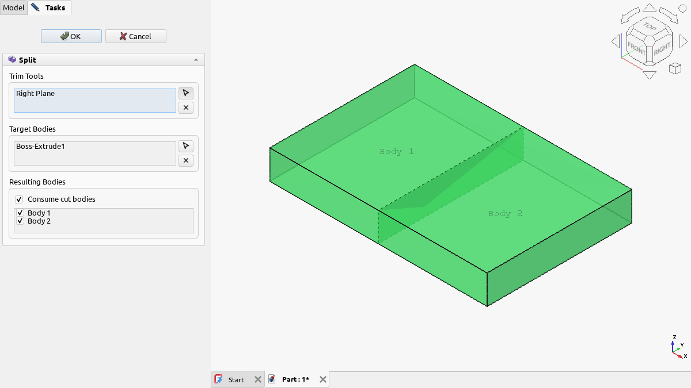

<!-- Generated by docs/build.py from docs/_data/catalog.json, docs/_authored/tools/split.md, docs/_data/panels.json. Do not edit this file: change its sources and run `pixi run docs`. -->

# Split

{ .tool-icon }
Splits bodies with planes, faces, surface bodies or sketches into separate bodies.
{ .tool-lead }

Split cuts bodies into separate bodies with planes, faces, surface bodies or sketches: a box into a base and a lid, a part into printable pieces.

## How to use it

1. Select the body and the cutting tools (planes, sketches, surfaces), or click **Split** and pick them.
2. The panel lists the pieces under **Resulting Bodies**. Untick any you don't want kept. For faces and surfaces, choose whether they cut only **Within their edges** or **Past their edges**.
3. Click **OK**.

## Good to know

- **Consume cut bodies** removes the original body; the pieces replace it.

## Where to find it

- The **Bodies** toolbar.
- **Solid Design** → **Bodies** → **Split**
- **Insert** → **Features** → **Split**
- Command search: press <kbd>/</kbd> in the 3D view and type its name.
- The command line: <kbd>:</kbd> then `split` ([below](#on-the-command-line)).

## The panel

Every control's tooltip says the same as here: hover over it in FreeCAD. **OK** (or <kbd>Enter</kbd>) makes the feature, **Cancel** (or <kbd>Esc</kbd>) leaves the model as it was.

### Trim Tools

| Control | Kind | What it does |
| :-- | :-- | :-- |
| **Trim tools** | Selection list: click planes, faces, surface bodies or sketches | What the bodies are split with: planes, faces, surface bodies or sketches |
| **Within their edges \\| Past their edges** | Buttons: *Within their edges* \\| *Past their edges* | How far the faces and surfaces cut *(shown for some choices only)* |

### Target Bodies

| Control | Kind | What it does |
| :-- | :-- | :-- |
| **Bodies** | Selection list: click bodies in the 3D view or tree | The bodies to split. Empty: every body the tools cut. |

### Resulting Bodies

| Control | Kind | What it does |
| :-- | :-- | :-- |
| **Consume cut bodies** | A check box | Delete the bodies that were split; off: keep them too |
|  | A list | Ticked pieces become bodies; double-click a name to change it. They are numbered in the 3D view. |

## On the command line

Press <kbd>:</kbd> in the 3D view and type `split`, then what to set. See [the command line](../../guides/keyboard.md) for how it works.

??? note "Options it takes"

    | Option | How to type it | What it is |
    | :-- | :-- | :-- |
    | `ExtendFaces` | `extendfaces` turns it on, `extendfaces=no` off | Faces and surfaces cut wherever their whole surface would go, not only within their edges |
    | `ConsumeCutBodies` | `consumecutbodies` turns it on, `consumecutbodies=no` off | Consume the bodies that are cut |
    | `KeepAll` | `keepall` turns it on, `keepall=no` off | Keep every piece |

## Properties

??? info "All properties"

    What the feature stores, as the **Property** editor shows it (select the feature in the tree, then the **Data** tab). The panel sets these for you.

    | Property | Kind | Default | What it is |
    | :-- | :-- | :-- | :-- |
    | `TrimTools` | Objects | – | Planes and sketches that cut |
    | `TrimFaces` | Picks | – | Faces of the model that cut |
    | `TrimBodies` | List | – | Surface bodies that cut, by ID |
    | `ExtendFaces` | Yes/No | No | Faces and surfaces cut wherever their whole surface would go, not only within their edges |
    | `TargetBodies` | List | – | Bodies to split (empty: all) |
    | `ConsumeCutBodies` | Yes/No | Yes | Consume the bodies that are cut |
    | `KeepAll` | Yes/No | Yes | Keep every piece |
    | `KeepPieces` | List | – | Pieces to keep, by ID |
    | `PieceNames` | Map | – | Names given to pieces (ID -> name) |

