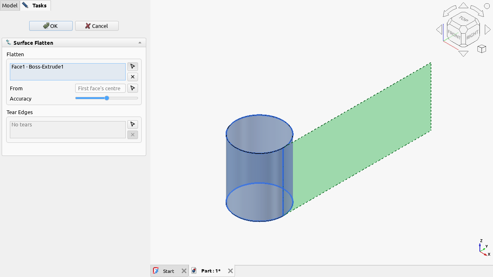

<!-- Generated by docs/build.py from docs/_data/catalog.json, docs/_authored/tools/surface-flatten.md, docs/_data/panels.json. Do not edit this file: change its sources and run `pixi run docs`. -->

# Surface Flatten

{ .tool-icon }
Lays faces out flat as a new surface body.
{ .tool-lead }

Surface Flatten lays faces out flat as a new surface body: a pattern for fabric, a label, sheet metal.

## How to use it

1. Select the faces and click **Surface Flatten**.
2. Optionally pick the point it flattens **From**, and edges to tear along.
3. Click **OK**.

## Where to find it

- The **Surfaces** toolbar, in the **More Surfaces** drop-down.
- **Solid Design** → **Surfaces** → **Surface Flatten**
- **Insert** → **Surface** → **Surface Flatten**
- Command search: press <kbd>/</kbd> in the 3D view and type its name.
- The command line: <kbd>:</kbd> then `surfaceflatten` ([below](#on-the-command-line)).

## The panel

Every control's tooltip says the same as here: hover over it in FreeCAD. **OK** (or <kbd>Enter</kbd>) makes the feature, **Cancel** (or <kbd>Esc</kbd>) leaves the model as it was.

### Flatten

| Control | Kind | What it does |
| :-- | :-- | :-- |
| **Faces** | Selection list: click faces | The faces to flatten (connected) |
| **From** | Selection box: click a vertex or edge | Where the flat shape touches the faces: a vertex, or an edge's middle. Empty: the first face's centre |
| **Accuracy** |  | Finer is truer to the faces, and slower |

### Tear Edges

Cut the faces open along these edges (relief cuts)

| Control | Kind | What it does |
| :-- | :-- | :-- |
| **Edges** | Selection list: click edges | Edges to cut open along; a closed set of faces (a whole body) needs them, like a net |

## On the command line

Press <kbd>:</kbd> in the 3D view and type `surfaceflatten`, then what to set. See [the command line](../../guides/keyboard.md) for how it works.

??? note "Options it takes"

    | Option | How to type it | What it is |
    | :-- | :-- | :-- |
    | `Accuracy` | `accuracy=`a value | Finer is truer and slower |

## Properties

??? info "All properties"

    What the feature stores, as the **Property** editor shows it (select the feature in the tree, then the **Data** tab). The panel sets these for you.

    | Property | Kind | Default | What it is |
    | :-- | :-- | :-- | :-- |
    | `Items` | Picks | – | The faces to flatten (connected) |
    | `FlattenFrom` | Picks | – | A vertex (or an edge's middle) where the flat shape touches the faces |
    | `Accuracy` | Percent | 50 | Finer is truer and slower |
    | `TearEdges` | Picks | – | Edges to cut the faces open along (relief cuts); a closed set needs them |

