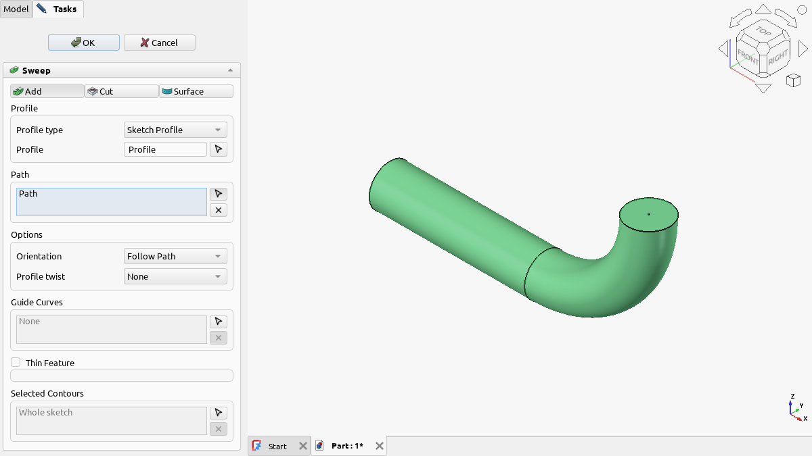

<!-- Generated by docs/build.py from docs/_data/catalog.json, docs/_authored/tools/sweep.md, docs/_data/panels.json. Do not edit this file: change its sources and run `pixi run docs`. -->

# Sweep

{ .tool-icon }
Sweeps a profile along a path to add material, or to cut it (Add | Cut in the panel).
{ .tool-lead }

Sweep moves a profile along a path: pipes, handles, springs, cable runs. **Add** grows material, **Cut** removes it, **Surface** makes a surface body.

## How to use it

1. Draw the profile (usually a closed sketch) and the path (a sketch, an edge, or a [curve](helix-spiral.md)). The profile should sit at the path's start, across it.
2. Select the profile sketch and click **Sweep**.
3. Click the path in the 3D view to fill **Path**.
4. Choose how the profile turns along the path (**Orientation**, **Profile twist**), then click **OK**.

## Good to know

- **Profile type** can be a circle instead of a sketch: give its diameter and the path is all you need (SolidWorks' circular profile).
- **Guide Curves** pull the profile's shape along the way.

## Where to find it

- The **Features** toolbar.
- **Solid Design** → **Features** → **Sweep**
- **Insert** → **Features** → **Sweep**
- Command search: press <kbd>/</kbd> in the 3D view and type its name.
- The command line: <kbd>:</kbd> then `sweep` ([below](#on-the-command-line)).

## The panel

Every control's tooltip says the same as here: hover over it in FreeCAD. **OK** (or <kbd>Enter</kbd>) makes the feature, **Cancel** (or <kbd>Esc</kbd>) leaves the model as it was.

| Control | Kind | What it does |
| :-- | :-- | :-- |
| **Add \\| Cut \\| Surface** | Buttons: *Add* \\| *Cut* \\| *Surface* |  |

### Profile

| Control | Kind | What it does |
| :-- | :-- | :-- |
| **Profile type** | One of: *Sketch Profile*, *Circular Profile*, *Solid Profile* | Sketch profile: sweep a sketch. Circular profile: sweep a circle of the diameter, as for wires and pipes. Solid profile: sweep a tool body of revolution, as a cutter moving along a groove. |
| **Diameter** | A length | Diameter of the circular profile *(shown for some choices only)* |
| **Tool body** | Selection box: click a body | The tool body: a body of revolution (a revolve or a cylinder). It isn't cut by the sweep. *(shown for some choices only)* |
| **Profile** | Selection box: click a sketch | The sketch swept along the path. Press the button, then click a sketch. |

### Path

| Control | Kind | What it does |
| :-- | :-- | :-- |
| **Path** | Selection list: click a path sketch or edges | The path: a sketch, or connected edges of the model or a sketch, in order |

### Options

| Control | Kind | What it does |
| :-- | :-- | :-- |
| **Orientation** | One of: *Follow Path*, *Keep Normal Constant*, *Specify Direction Vector*, *Tangent to Adjacent Faces*, *Natural* | Follow Path: the profile turns with the path. Keep Normal Constant: it keeps facing the same way. Specify Direction Vector: it keeps its top towards a direction. Tangent to Adjacent Faces: it keeps square to the faces beside a path of model edges. Natural: it turns with the path's curvature. |
| **Direction** | Selection box: click an edge, axis or plane | The direction the profile keeps its top towards *(shown for some choices only)* |
| **Profile twist** | One of: *None*, *Specify Twist Value*, *Follow Path and 1st Guide Curve*, *Follow 1st and 2nd Guide Curves* | None: no twist. Specify Twist Value: turn the profile evenly along the path. Follow Path and 1st Guide Curve: turn it to keep touching the guide curve. Follow 1st and 2nd Guide Curves: the line between the two guides turns it. |
| **Twist control** | One of: *Degrees*, *Turns* | Give the twist in degrees or in turns *(shown for some choices only)* |
| **Twist** | A number | How far the profile turns along the whole path *(a flip button beside it; shown for some choices only)* |
| **Turns** | A number | How many turns the profile makes along the path *(a flip button beside it; shown for some choices only)* |
| **Merge result** | A check box | Fuse the new material with the bodies it touches. Off: it becomes a body of its own. *(shown for some choices only)* |
| **Flip side to cut** | A check box | Remove the material outside the profile instead of inside it *(shown for some choices only)* |

### Guide Curves

Curves the profile follows: it is scaled (and, with two or more, turned and moved) to keep touching them

| Control | Kind | What it does |
| :-- | :-- | :-- |
| **Guide curves** | Selection list: click guide curve sketches | Sketches whose curves the profile follows; each must touch the profile |

### Start/End Tangency

*Shown only for some choices above.*

| Control | Kind | What it does |
| :-- | :-- | :-- |
| **Start tangency** | One of: *None*, *Path Tangent* | Path Tangent: the sweep leaves the start square to the path, even where guide curves flare it |
| **End tangency** | One of: *None*, *Path Tangent* | Path Tangent: the sweep arrives square to the path |

### Thin Feature

Make a wall of constant thickness from the sketch's curves instead of filling it

*Optional: tick its title to use it.*

| Control | Kind | What it does |
| :-- | :-- | :-- |
| **Type** | One of: *One-Direction*, *Mid-Plane*, *Two-Direction* | Which side of the curves the wall grows on *(a flip button beside it; shown for some choices only)* |
| **Thickness** | A length | Wall thickness *(shown for some choices only)* |
| **Thickness 2** | A length | Wall thickness on the second side *(shown for some choices only)* |

### Selected Contours

| Control | Kind | What it does |
| :-- | :-- | :-- |
| **Regions** | Selection list: click inside regions of the sketch | Use only some regions of the sketch: click inside them in the 3D view. Empty: the whole sketch. |

### Feature Scope

Which bodies the feature works on

*Shown only for some choices above.*

| Control | Kind | What it does |
| :-- | :-- | :-- |
| **All bodies \\| Selected bodies** | Buttons: *All bodies* \\| *Selected bodies* |  |
| **Auto-select** | A check box | Use the bodies the feature touches; untick to choose them *(shown for some choices only)* |
| **Bodies** | Selection list: click bodies in the 3D view or tree | The bodies the feature works on *(shown for some choices only)* |

### Bodies to Keep

The cut splits a body: choose which pieces to keep

*Shown only for some choices above.*

| Control | Kind | What it does |
| :-- | :-- | :-- |
| **All bodies \\| Selected bodies** | Buttons: *All bodies* \\| *Selected bodies* |  |
|  | A list | Tick the pieces to keep. They are numbered in the 3D view. |

## On the command line

Press <kbd>:</kbd> in the 3D view and type `sweep`, then what to set. See [the command line](../../guides/keyboard.md) for how it works.

??? note "Options it takes"

    | Option | How to type it | What it is |
    | :-- | :-- | :-- |
    | `Mode` | a word: `add`, `cut`, `surface` | Add material, cut it, or make a surface body |
    | `Thin` | `thin` turns it on, `thin=no` off | Thin Feature on/off |
    | `ThinType` | a word: `onedirection`, `midplane`, `twodirection` | Thin type |
    | `ThinThickness` | `thinthickness=`a value | Thickness |
    | `ThinThickness2` | `thinthickness2=`a value | Thickness 2 (Two-Direction) |
    | `ThinReverse` | `thinreverse` turns it on, `thinreverse=no` off | Reverse the thin direction |
    | `MergeResult` | `mergeresult` turns it on, `mergeresult=no` off | Merge result (Add mode) |
    | `FeatureScope` | a word: `allbodies`, `selectedbodies` | Feature scope |
    | `AutoSelect` | `autoselect` turns it on, `autoselect=no` off | Auto-select the bodies in scope |
    | `BodiesToKeep` | a word: `allbodies`, `selectedbodies` | Bodies to Keep |
    | `FlipSideToCut` | `flipsidetocut` turns it on, `flipsidetocut=no` off | Flip side to cut (Cut mode) |
    | `ProfileType` | a word: `sketchprofile`, `circularprofile`, `solidprofile` | Sketch or circular profile |
    | `Diameter` | `diameter=`a value | Circular profile diameter |
    | `Orientation` | a word: `followpath`, `keepnormalconstant`, `specifydirectionvector`, `tangenttoadjacentfaces`, `natural` | Profile orientation |

## Properties

??? info "All properties"

    What the feature stores, as the **Property** editor shows it (select the feature in the tree, then the **Data** tab). The panel sets these for you.

    | Property | Kind | Default | What it is |
    | :-- | :-- | :-- | :-- |
    | `Mode` | Choice | Add | Add material, cut it, or make a surface body Choices: *Add*, *Cut*, *Surface*. |
    | `Sketch` | Object | – | The profile sketch |
    | `Contours` | List | – | Selected Contours: regions of the sketch (bounding geometry IDs + a point inside) |
    | `Thin` | Yes/No | No | Thin Feature on/off |
    | `ThinType` | Choice | One-Direction | Thin type Choices: *One-Direction*, *Mid-Plane*, *Two-Direction*. |
    | `ThinThickness` | Length | 1 mm | Thickness |
    | `ThinThickness2` | Length | 1 mm | Thickness 2 (Two-Direction) |
    | `ThinReverse` | Yes/No | No | Reverse the thin direction |
    | `MergeResult` | Yes/No | Yes | Merge result (Add mode) |
    | `FeatureScope` | Choice | All bodies | Feature scope Choices: *All bodies*, *Selected bodies*. |
    | `AutoSelect` | Yes/No | Yes | Auto-select the bodies in scope |
    | `ScopeBodies` | List | – | Body IDs in scope |
    | `BodiesToKeep` | Choice | All bodies | Bodies to Keep Choices: *All bodies*, *Selected bodies*. |
    | `KeepBodies` | List | – | Piece IDs to keep |
    | `FlipSideToCut` | Yes/No | No | Flip side to cut (Cut mode) |
    | `ProfileType` | Choice | Sketch Profile | Sketch or circular profile Choices: *Sketch Profile*, *Circular Profile*, *Solid Profile*. |
    | `Diameter` | Length | 5 mm | Circular profile diameter |
    | `Path` | Picks | – | Path: a sketch, or connected edges |
    | `Orientation` | Choice | Follow Path | Profile orientation Choices: *Follow Path*, *Keep Normal Constant*, *Specify Direction Vector*, *Tangent to Adjacent Faces*, *Natural*. |
    | `DirectionVector` | Picks | – | Specify Direction Vector: the way the profile keeps facing (edge, axis or plane) |
    | `ToolBody` | Text | – | Solid profile: the tool body, by ID |

