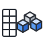
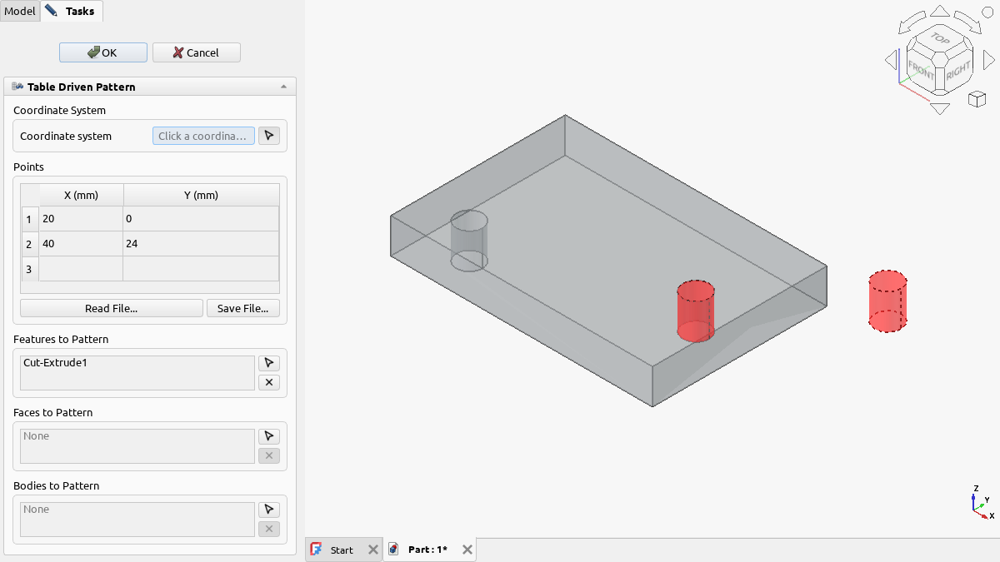

<!-- Generated by docs/build.py from docs/_data/catalog.json, docs/_authored/tools/table-driven-pattern.md, docs/_data/panels.json. Do not edit this file: change its sources and run `pixi run docs`. -->

# Table Driven Pattern

{ .tool-icon }
Repeats features or bodies at X, Y positions you type in.
{ .tool-lead }

Table Driven Pattern places copies at X, Y positions you type, measured in a coordinate system.

## How to use it

1. Select the features to repeat and click **Table Driven Pattern**.
2. Optionally click a [coordinate system](coordinate-system.md); without one the part's origin is used.
3. Type each copy's X and Y in the **Points** table. A new empty row appears as you fill the last one.
4. Click **OK**.

## Good to know

- **Read File** and **Save File** load and save the points as a text file.

## Where to find it

- The **Features** toolbar, in the **Patterns** drop-down.
- **Solid Design** → **Patterns** → **Table Driven Pattern**
- **Insert** → **Pattern/Mirror** → **Table Driven Pattern**
- Command search: press <kbd>/</kbd> in the 3D view and type its name.
- The command line: <kbd>:</kbd> then `tabledrivenpattern`.

## The panel

Every control's tooltip says the same as here: hover over it in FreeCAD. **OK** (or <kbd>Enter</kbd>) makes the feature, **Cancel** (or <kbd>Esc</kbd>) leaves the model as it was.

### Coordinate System

| Control | Kind | What it does |
| :-- | :-- | :-- |
| **Coordinate system** | Selection box: click a coordinate system | The X and Y values are in this coordinate system (none: the part's origin) |

### Points

Where each instance's centre goes (the original's centre is point 0)

| Control | Kind | What it does |
| :-- | :-- | :-- |
|  | A table: X (mm), Y (mm) | Type the X and Y of each instance; the last row is always empty for a new point |
| **Read File...** | A button | Read or save the points as a table file *(a **Save File...** button)* |

### Features to Pattern

| Control | Kind | What it does |
| :-- | :-- | :-- |
| **Features** | Selection list: click features in the tree, or their faces | The features to repeat: click them in the tree, or click a face they made |

### Faces to Pattern

| Control | Kind | What it does |
| :-- | :-- | :-- |
| **Faces** | Selection list: click faces | Every face of a boss, hole or pocket to repeat (its walls and top or floor). Material is added where they bound material, cut where they bound a gap. |

### Bodies to Pattern

| Control | Kind | What it does |
| :-- | :-- | :-- |
| **Bodies** | Selection list: click bodies in the 3D view or tree | Whole bodies to repeat |

## Properties

??? info "All properties"

    What the feature stores, as the **Property** editor shows it (select the feature in the tree, then the **Data** tab). The panel sets these for you.

    | Property | Kind | Default | What it is |
    | :-- | :-- | :-- | :-- |
    | `Features` | Objects | – | Features to repeat |
    | `Bodies` | List | – | Bodies to repeat, by ID |
    | `Faces` | Picks | – | Faces to repeat: every face of a boss, hole or pocket |
    | `CoordinateSystem` | Object | – | The coordinate system the X and Y values are in (none: the part's origin) |
    | `Points` | List | – | Instance positions, as X,Y |

