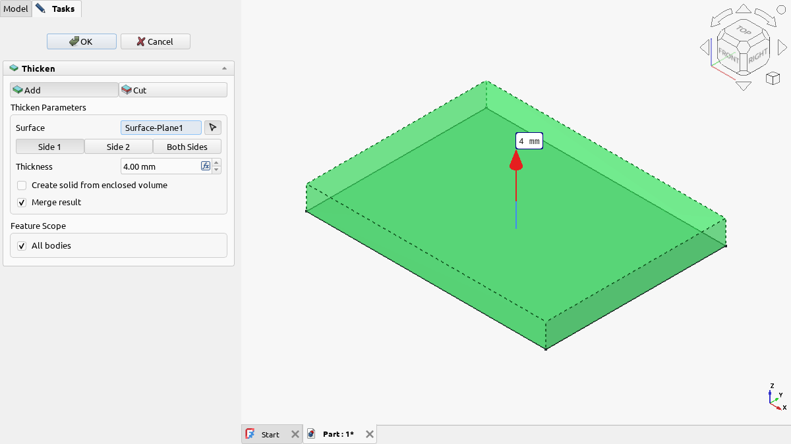

<!-- Generated by docs/build.py from docs/_data/catalog.json, docs/_authored/tools/thicken.md, docs/_data/panels.json. Do not edit this file: change its sources and run `pixi run docs`. -->

# Thicken

{ .tool-icon }
Thickens a surface body into a solid, or cuts the solids with it (Add | Cut in the panel).
{ .tool-lead }

Thicken turns a surface body into a solid by giving it a thickness, or cuts the solids with that thickness (**Cut**).

## How to use it

1. Select the surface body and click **Thicken**.
2. Choose the side (**Side 1**, **Side 2** or **Both Sides**) and the **Thickness**.
3. Click **OK**.

## Good to know

- **Create solid from enclosed volume** fills a closed surface instead of thickening it.

## Where to find it

- The **Surfaces** toolbar.
- **Solid Design** → **Surfaces** → **Thicken**
- **Insert** → **Surface** → **Thicken**
- Command search: press <kbd>/</kbd> in the 3D view and type its name.
- The command line: <kbd>:</kbd> then `thicken` ([below](#on-the-command-line)).

## The panel

Every control's tooltip says the same as here: hover over it in FreeCAD. **OK** (or <kbd>Enter</kbd>) makes the feature, **Cancel** (or <kbd>Esc</kbd>) leaves the model as it was.

| Control | Kind | What it does |
| :-- | :-- | :-- |
| **Add \\| Cut** | Buttons: *Add* \\| *Cut* |  |

### Thicken Parameters

| Control | Kind | What it does |
| :-- | :-- | :-- |
| **Surface** | Selection box: click a body | The surface to thicken; it is used up |
| **Side 1 \\| Side 2 \\| Both Sides** | Buttons: *Side 1* \\| *Side 2* \\| *Both Sides* |  |
| **Thickness** | A length | How thick |
| **Create solid from enclosed volume** | A check box | A closed surface: the solid inside it |
| **Merge result** | A check box | Fuse with the solids it touches |

### Feature Scope

Which solids it works on

| Control | Kind | What it does |
| :-- | :-- | :-- |
| **All bodies** | A check box | Work on every solid it reaches; untick to choose them |

### Bodies in Scope

*Shown only for some choices above.*

| Control | Kind | What it does |
| :-- | :-- | :-- |
| **Bodies** | Selection list: click solids | The solids it works on |

## Drag handles

While the panel is open, drag the handles in the 3D view to set **Thickness**, or click a handle's value and type. The same handles show when you select the feature in the tree, so you can change it without opening the panel. See [drag handles](../../guides/drag-handles.md).

## On the command line

Press <kbd>:</kbd> in the 3D view and type `thicken`, then what to set. See [the command line](../../guides/keyboard.md) for how it works.

Values typed straight after the name set, in order: **Thickness**. For example `:thicken 1`.

??? note "Options it takes"

    | Option | How to type it | What it is |
    | :-- | :-- | :-- |
    | `Mode` | a word: `add`, `cut` | Add (Thicken) or Cut (Thickened Cut) |
    | `Thickness` | `thickness=`a value | Thickness |
    | `ThickenSide` | a word: `side1`, `side2`, `bothsides` | Side 1 / Side 2: one side of the surface. Both Sides: half each |
    | `CreateSolid` | `createsolid` turns it on, `createsolid=no` off | Create solid from enclosed volume (a closed surface) |
    | `MergeResult` | `mergeresult` turns it on, `mergeresult=no` off | Fuse with the solids it touches (Thicken) |
    | `AllBodies` | `allbodies` turns it on, `allbodies=no` off | Work on every solid it reaches; off: only the Scope Bodies |

## Properties

??? info "All properties"

    What the feature stores, as the **Property** editor shows it (select the feature in the tree, then the **Data** tab). The panel sets these for you.

    | Property | Kind | Default | What it is |
    | :-- | :-- | :-- | :-- |
    | `Mode` | Choice | Add | Add (Thicken) or Cut (Thickened Cut) Choices: *Add*, *Cut*. |
    | `Body` | Text |  | The surface body to thicken, by ID |
    | `Thickness` | Length | 1 mm | Thickness |
    | `ThickenSide` | Choice | Side 1 | Side 1 / Side 2: one side of the surface. Both Sides: half each Choices: *Side 1*, *Side 2*, *Both Sides*. |
    | `CreateSolid` | Yes/No | No | Create solid from enclosed volume (a closed surface) |
    | `MergeResult` | Yes/No | Yes | Fuse with the solids it touches (Thicken) |
    | `AllBodies` | Yes/No | Yes | Work on every solid it reaches; off: only the Scope Bodies |
    | `ScopeBodies` | List | – | The solids it works on, by ID |

