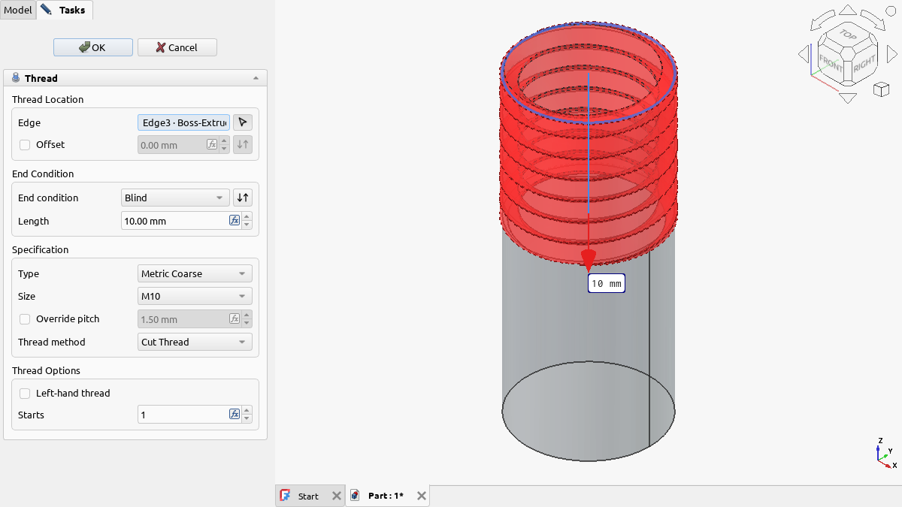

<!-- Generated by docs/build.py from docs/_data/catalog.json, docs/_authored/tools/thread.md, docs/_data/panels.json. Do not edit this file: change its sources and run `pixi run docs`. -->

# Thread

{ .tool-icon }
Models a helical thread on a shaft or in a hole, starting at a circular edge: cut into it, or grown out of it.
{ .tool-lead }

Thread models a real helical thread on a shaft or in a hole, for 3D printing or close-up renders. For a drawing callout without the geometry, use [Cosmetic Thread](cosmetic-thread.md).

## How to use it

1. Select the circular edge where the thread starts (the end of a shaft, the rim of a hole).
2. Click **Thread**. The size is set to the nearest standard one for the diameter.
3. Set the **End condition** and **Length**, and the **Thread method**: **Cut Thread** cuts the groove in, **Extrude Thread** grows the ridge out.
4. Click **OK**.

## Good to know

- **Override pitch** sets a pitch of your own; **Left-hand thread** and **Starts** cover the rest.
- Threads are heavy geometry: model them last, or suppress them while you work.

## Where to find it

- The **Features** toolbar, in the **Threads** drop-down.
- **Solid Design** → **Features** → **Thread**
- Command search: press <kbd>/</kbd> in the 3D view and type its name.
- The command line: <kbd>:</kbd> then `thread` ([below](#on-the-command-line)).

## The panel

Every control's tooltip says the same as here: hover over it in FreeCAD. **OK** (or <kbd>Enter</kbd>) makes the feature, **Cancel** (or <kbd>Esc</kbd>) leaves the model as it was.

### Thread Location

| Control | Kind | What it does |
| :-- | :-- | :-- |
| **Edge** | Selection box: click a circular edge | The circular edge the thread starts at: a shaft's end or a hole's rim |
| **Offset** | A length | Start the thread away from the edge *(a flip button beside it; tick it to use it)* |

### End Condition

| Control | Kind | What it does |
| :-- | :-- | :-- |
| **End condition** | One of: *Blind*, *Revolutions*, *Up To Selection* | Blind: a length. Revolutions: a number of turns. Up To Selection: to a face, plane or vertex. *(a flip button beside it)* |
| **Length** | A length | Thread length |
| **Revolutions** | A number | Number of turns *(shown for some choices only)* |
| **Up to** | Selection box: click a face, plane or vertex | The face, plane or vertex the thread ends at *(shown for some choices only)* |

### Specification

| Control | Kind | What it does |
| :-- | :-- | :-- |
| **Type** | One of: *Metric Coarse*, *Metric Fine*, *Unified Coarse (UNC)*, *Unified Fine (UNF)* | The thread standard: ISO metric coarse or fine, or Unified inch coarse (UNC) or fine (UNF) |
| **Size** | One of: *M1.6*, *M2*, *M2.5*, *M3*, *M4*, *M5*, *M6*, *M8*, *M10*, *M12*, *M14*, *M16*, *M18*, *M20*, *M22*, *M24*, *M27*, *M30*, *M33*, *M36* | The thread size; it starts at the one nearest the cylinder |
| **Override pitch** | A length | Use your own pitch instead of the size's *(tick it to use it)* |
| **Thread method** | One of: *Cut Thread*, *Extrude Thread* | Cut Thread: cut the groove into the cylinder. Extrude Thread: grow the ridge out of it. |

### Thread Options

| Control | Kind | What it does |
| :-- | :-- | :-- |
| **Left-hand thread** | A check box | Turn the other way (off: a right-hand thread) |
| **Starts** | A count | Number of threads side by side (a multi-start thread) |

## Drag handles

While the panel is open, drag the handles in the 3D view to set **Length**, or click a handle's value and type. The same handles show when you select the feature in the tree, so you can change it without opening the panel. See [drag handles](../../guides/drag-handles.md).

## On the command line

Press <kbd>:</kbd> in the 3D view and type `thread`, then what to set. See [the command line](../../guides/keyboard.md) for how it works.

Values typed straight after the name set, in order: **Length**. For example `:thread 10`.

??? note "Options it takes"

    | Option | How to type it | What it is |
    | :-- | :-- | :-- |
    | `Offset` | `offset` turns it on, `offset=no` off | Start the thread away from the edge |
    | `OffsetDistance` | `offsetdistance=`a value | How far from the edge |
    | `ReverseOffset` | `reverseoffset` turns it on, `reverseoffset=no` off | Offset the other way |
    | `EndCondition` | a word: `blind`, `revolutions`, `uptoselection` | How long the thread is |
    | `Length` | `length=`a value | Thread length (Blind) |
    | `Revolutions` | `revolutions=`a value | Number of turns (Revolutions) |
    | `ReverseDirection` | `reversedirection` turns it on, `reversedirection=no` off | Thread the other way along the cylinder from the edge |
    | `Series` | a word: `metriccoarse`, `metricfine`, `unifiedcoarseunc`, `unifiedfineunf` | Thread standard and series |
    | `OverridePitch` | `overridepitch` turns it on, `overridepitch=no` off | Use your own pitch |
    | `Pitch` | `pitch=`a value | Pitch (Override pitch) |
    | `Method` | a word: `cutthread`, `extrudethread` | Cut the groove or grow the ridge |
    | `LeftHand` | `lefthand` turns it on, `lefthand=no` off | Left-hand thread |
    | `Starts` | `starts=`a whole number | Number of starts |

## Properties

??? info "All properties"

    What the feature stores, as the **Property** editor shows it (select the feature in the tree, then the **Data** tab). The panel sets these for you.

    | Property | Kind | Default | What it is |
    | :-- | :-- | :-- | :-- |
    | `Edge` | Picks | – | The circular edge the thread starts at |
    | `Offset` | Yes/No | No | Start the thread away from the edge |
    | `OffsetDistance` | Length | 0 mm | How far from the edge |
    | `ReverseOffset` | Yes/No | No | Offset the other way |
    | `EndCondition` | Choice | Blind | How long the thread is Choices: *Blind*, *Revolutions*, *Up To Selection*. |
    | `Length` | Length | 10 mm | Thread length (Blind) |
    | `Revolutions` | Number | 5 | Number of turns (Revolutions) |
    | `UpTo` | Picks | – | Face, plane or vertex (Up To Selection) |
    | `ReverseDirection` | Yes/No | No | Thread the other way along the cylinder from the edge |
    | `Series` | Choice | Metric Coarse | Thread standard and series Choices: *Metric Coarse*, *Metric Fine*, *Unified Coarse (UNC)*, *Unified Fine (UNF)*. |
    | `Size` | Text |  | Thread size (empty: the nearest one) |
    | `OverridePitch` | Yes/No | No | Use your own pitch |
    | `Pitch` | Length | 1 mm | Pitch (Override pitch) |
    | `Method` | Choice | Cut Thread | Cut the groove or grow the ridge Choices: *Cut Thread*, *Extrude Thread*. |
    | `LeftHand` | Yes/No | No | Left-hand thread |
    | `Starts` | Whole number | 1 | Number of starts |

