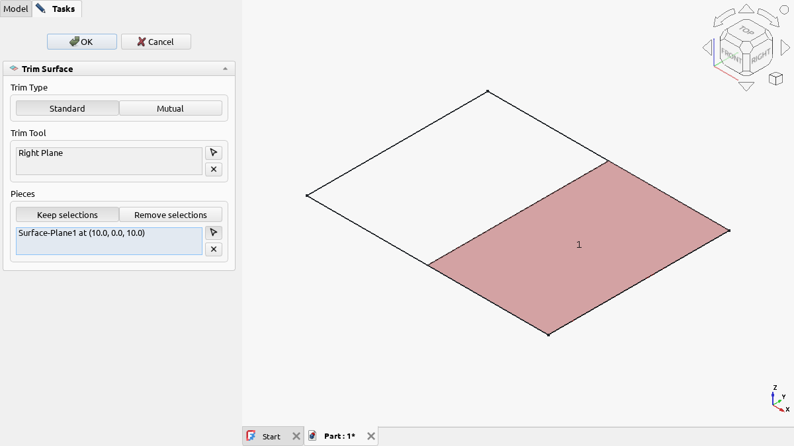

<!-- Generated by docs/build.py from docs/_data/catalog.json, docs/_authored/tools/trim-surface.md, docs/_data/panels.json. Do not edit this file: change its sources and run `pixi run docs`. -->

# Trim Surface

{ .tool-icon }
Trims surfaces with a plane, sketch or surface, or with each other; click the pieces to keep or remove.
{ .tool-lead }

Trim Surface cuts surfaces with a plane, sketch or surface, or two surfaces with each other, and keeps the pieces you choose.

## How to use it

1. Select the trim tool (a plane, a sketch or a surface) and click **Trim Surface**. For surfaces trimming each other, choose **Mutual** under **Trim Type**.
2. Click the pieces in the 3D view.
3. Choose **Keep selections** or **Remove selections**.
4. Click **OK**.

## Where to find it

- The **Surfaces** toolbar.
- **Solid Design** → **Surfaces** → **Trim Surface**
- **Insert** → **Surface** → **Trim Surface**
- Command search: press <kbd>/</kbd> in the 3D view and type its name.
- The command line: <kbd>:</kbd> then `trimsurface` ([below](#on-the-command-line)).

## The panel

Every control's tooltip says the same as here: hover over it in FreeCAD. **OK** (or <kbd>Enter</kbd>) makes the feature, **Cancel** (or <kbd>Esc</kbd>) leaves the model as it was.

### Trim Type

| Control | Kind | What it does |
| :-- | :-- | :-- |
| **Standard \\| Mutual** | Buttons: *Standard* \\| *Mutual* |  |

### Trim Tool

| Control | Kind | What it does |
| :-- | :-- | :-- |
| **Trim tools** | Selection list: click a plane, sketch, face or surface | What trims the surfaces: planes, sketches, faces or surface bodies |

### Surfaces

*Shown only for some choices above.*

| Control | Kind | What it does |
| :-- | :-- | :-- |
| **Bodies** | Selection list: click surface bodies | Mutual: the surfaces that trim each other |

### Pieces

| Control | Kind | What it does |
| :-- | :-- | :-- |
| **Keep selections \\| Remove selections** | Buttons: *Keep selections* \\| *Remove selections* |  |
| **Pieces** | Selection list: click pieces in the 3D view | The pieces to keep or remove: click on them in the 3D view |

## On the command line

Press <kbd>:</kbd> in the 3D view and type `trimsurface`, then what to set. See [the command line](../../guides/keyboard.md) for how it works.

??? note "Options it takes"

    | Option | How to type it | What it is |
    | :-- | :-- | :-- |
    | `TrimType` | a word: `standard`, `mutual` | Standard: a tool trims the surfaces. Mutual: surfaces trim each other |
    | `KeepSelections` | `keepselections` turns it on, `keepselections=no` off | Keep the picked pieces (else remove them) |

## Properties

??? info "All properties"

    What the feature stores, as the **Property** editor shows it (select the feature in the tree, then the **Data** tab). The panel sets these for you.

    | Property | Kind | Default | What it is |
    | :-- | :-- | :-- | :-- |
    | `TrimType` | Choice | Standard | Standard: a tool trims the surfaces. Mutual: surfaces trim each other Choices: *Standard*, *Mutual*. |
    | `TrimTools` | Objects | – | Planes and sketches that trim |
    | `TrimFaces` | Picks | – | Faces of the model that trim |
    | `TrimBodies` | List | – | Surface bodies that trim, by ID |
    | `Bodies` | List | – | Mutual: the surfaces; Standard: the surfaces to trim (empty: all it cuts) |
    | `PickedPoints` | List | – | Points on the picked pieces (x,y,z) |
    | `KeepSelections` | Yes/No | Yes | Keep the picked pieces (else remove them) |

