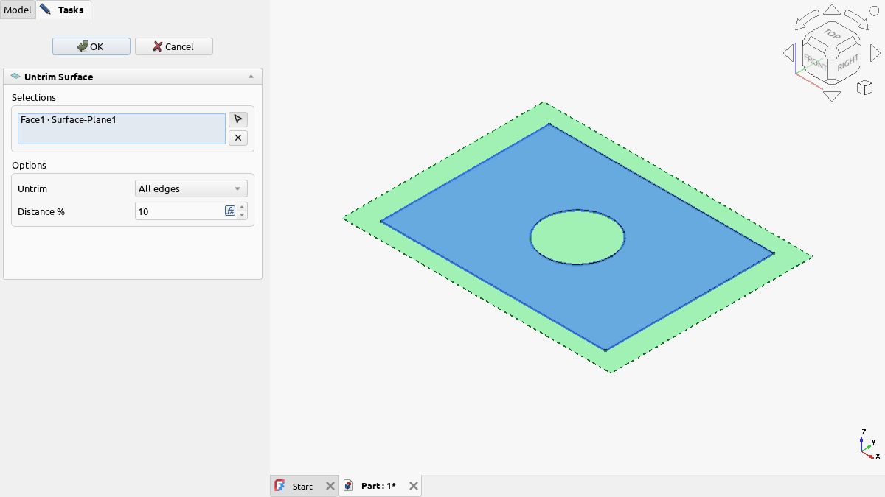

<!-- Generated by docs/build.py from docs/_data/catalog.json, docs/_authored/tools/untrim-surface.md, docs/_data/panels.json. Do not edit this file: change its sources and run `pixi run docs`. -->

# Untrim Surface

{ .tool-icon }
A face back to the surface it lies on: holes filled, or grown past its edges.
{ .tool-lead }

Untrim Surface takes a face back to the surface it lies on: its holes filled, or grown out past its edges.

## How to use it

1. Select the face and click **Untrim Surface**.
2. Choose what to **Untrim**: **Internal edges** fills the face's holes, **External edges** grows it past its outline and keeps the holes, **All edges** does both. **Distance %** says how far it grows.
3. Click **OK**.

## Where to find it

- The **Surfaces** toolbar, in the **More Surfaces** drop-down.
- **Solid Design** → **Surfaces** → **Untrim Surface**
- **Insert** → **Surface** → **Untrim Surface**
- Command search: press <kbd>/</kbd> in the 3D view and type its name.
- The command line: <kbd>:</kbd> then `untrimsurface` ([below](#on-the-command-line)).

## The panel

Every control's tooltip says the same as here: hover over it in FreeCAD. **OK** (or <kbd>Enter</kbd>) makes the feature, **Cancel** (or <kbd>Esc</kbd>) leaves the model as it was.

### Selections

| Control | Kind | What it does |
| :-- | :-- | :-- |
| **Faces** | Selection list: click faces | The faces to untrim |

### Options

| Control | Kind | What it does |
| :-- | :-- | :-- |
| **Untrim** | One of: *All edges*, *Internal edges*, *External edges* | Internal edges: fill the face's holes. All edges: the whole surface it lies on, grown by the percentage. External edges: grown, holes kept. |
| **Distance %** | A count | How much bigger than the face, in each direction |

## On the command line

Press <kbd>:</kbd> in the 3D view and type `untrimsurface`, then what to set. See [the command line](../../guides/keyboard.md) for how it works.

??? note "Options it takes"

    | Option | How to type it | What it is |
    | :-- | :-- | :-- |
    | `UntrimType` | a word: `alledges`, `internaledges`, `externaledges` | Internal edges: fill the holes. All edges: the whole surface, grown. External edges: grown, holes kept |
    | `DistancePercent` | `distancepercent=`a value | How much bigger (All / External) |

## Properties

??? info "All properties"

    What the feature stores, as the **Property** editor shows it (select the feature in the tree, then the **Data** tab). The panel sets these for you.

    | Property | Kind | Default | What it is |
    | :-- | :-- | :-- | :-- |
    | `Items` | Picks | – | Faces to untrim |
    | `UntrimType` | Choice | All edges | Internal edges: fill the holes. All edges: the whole surface, grown. External edges: grown, holes kept Choices: *All edges*, *Internal edges*, *External edges*. |
    | `DistancePercent` | Percent | 10 | How much bigger (All / External) |

