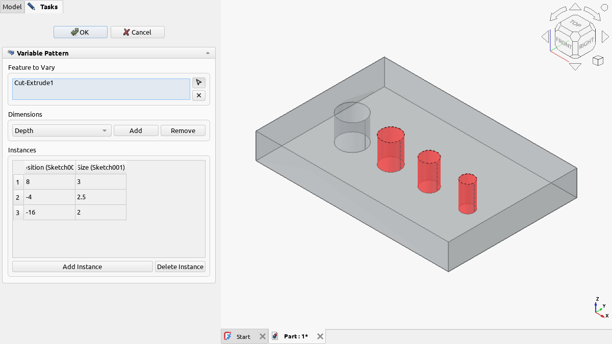

<!-- Generated by docs/build.py from docs/_data/catalog.json, docs/_authored/tools/variable-pattern.md, docs/_data/panels.json. Do not edit this file: change its sources and run `pixi run docs`. -->

# Variable Pattern

{ .tool-icon }
Repeats a feature with its dimensions changed per instance, from a table: position, size or depth.
{ .tool-lead }

Variable Pattern copies a feature with its dimensions changed per copy, from a table: holes of growing size, ribs of falling height.

## How to use it

1. Give the dimensions you want to vary a name in the sketch (a named constraint), or use the feature's own (its depth).
2. Select the feature and click **Variable Pattern**.
3. Under **Dimensions**, pick a dimension and click **Add**; it becomes a column.
4. Click **Add Instance** for each copy and type its values in the table.
5. Click **OK**.

## Where to find it

- The **Features** toolbar, in the **Patterns** drop-down.
- **Solid Design** → **Patterns** → **Variable Pattern**
- **Insert** → **Pattern/Mirror** → **Variable Pattern**
- Command search: press <kbd>/</kbd> in the 3D view and type its name.
- The command line: <kbd>:</kbd> then `variablepattern`.

## The panel

Every control's tooltip says the same as here: hover over it in FreeCAD. **OK** (or <kbd>Enter</kbd>) makes the feature, **Cancel** (or <kbd>Esc</kbd>) leaves the model as it was.

### Feature to Vary

An Extrude or a Revolve

| Control | Kind | What it does |
| :-- | :-- | :-- |
| **Features** | Selection list: click features in the tree, or their faces | The feature to vary: click it in the tree, or a face it made |

### Dimensions

The feature's own, and its sketch's named dimensions

| Control | Kind | What it does |
| :-- | :-- | :-- |
|  | One of: *Depth* | Pick a dimension and Add it *(a **Add** button; a **Remove** button)* |

### Instances

One row per instance; the original isn't in the table

| Control | Kind | What it does |
| :-- | :-- | :-- |
|  | A table: Position (Sketch001), Size (Sketch001) | Type each instance's values |
| **Add Instance** | A button | Add or delete instances *(a **Delete Instance** button)* |

## Properties

??? info "All properties"

    What the feature stores, as the **Property** editor shows it (select the feature in the tree, then the **Data** tab). The panel sets these for you.

    | Property | Kind | Default | What it is |
    | :-- | :-- | :-- | :-- |
    | `Features` | Objects | – | Features to repeat |
    | `Dimensions` | List | – | The dimensions each instance changes: a feature property (Depth) or a sketch dimension (Sketch:Name) |
    | `Instances` | List | – | One row per instance: its values, in the Dimensions' order, separated by ; |

