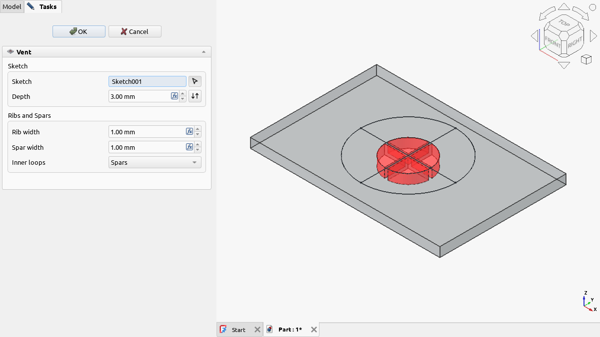

<!-- Generated by docs/build.py from docs/_data/catalog.json, docs/_authored/tools/vent.md, docs/_data/panels.json. Do not edit this file: change its sources and run `pixi run docs`. -->

# Vent

{ .tool-icon }
Cuts a vent from a sketch: its outer loop opens the wall, its lines stay as ribs and its inner loops as spars.
{ .tool-lead }

Vent cuts a vent from one sketch: its outer loop opens the wall, its lines stay as ribs and its inner loops as spars.

## How to use it

1. Sketch the vent on (or above) a face: an outer loop, lines across it for ribs, and inner loops for spars.
2. Select the sketch and click **Vent**.
3. Set the **Depth** of the cut, the **Rib width** and **Spar width**, and whether inner loops make **Spars** or are filled in (**Fill-in**).
4. Click **OK**.

## Where to find it

- The **Features** toolbar, in the **Fastening Features** drop-down.
- **Solid Design** → **Features** → **Vent**
- Command search: press <kbd>/</kbd> in the 3D view and type its name.
- The command line: <kbd>:</kbd> then `vent` ([below](#on-the-command-line)).

## The panel

Every control's tooltip says the same as here: hover over it in FreeCAD. **OK** (or <kbd>Enter</kbd>) makes the feature, **Cancel** (or <kbd>Esc</kbd>) leaves the model as it was.

### Sketch

The outer loop is the vent; lines are ribs, inner loops spars

| Control | Kind | What it does |
| :-- | :-- | :-- |
| **Sketch** | Selection box: click a sketch | The vent's sketch |
| **Depth** | A length | How deep it cuts (the wall's thickness) *(a flip button beside it)* |

### Ribs and Spars

| Control | Kind | What it does |
| :-- | :-- | :-- |
| **Rib width** | A length | Width of the ribs (the sketch's lines) |
| **Spar width** | A length | Width of the spars (inner loops) |
| **Inner loops** | One of: *Spars*, *Fill-in* | Spars: a ring of material along each inner loop. Fill-in: the loop is kept solid |

## On the command line

Press <kbd>:</kbd> in the 3D view and type `vent`, then what to set. See [the command line](../../guides/keyboard.md) for how it works.

??? note "Options it takes"

    | Option | How to type it | What it is |
    | :-- | :-- | :-- |
    | `Depth` | `depth=`a value | How deep it cuts (the wall's thickness) |
    | `ReverseDirection` | `reversedirection` turns it on, `reversedirection=no` off | Cut the other way from the sketch |
    | `RibWidth` | `ribwidth=`a value | Rib width |
    | `SparWidth` | `sparwidth=`a value | Spar width |
    | `InnerLoops` | a word: `spars`, `fillin` | Inner loops: Spars (a ring of material along them) or Fill-in (kept solid) |

## Properties

??? info "All properties"

    What the feature stores, as the **Property** editor shows it (select the feature in the tree, then the **Data** tab). The panel sets these for you.

    | Property | Kind | Default | What it is |
    | :-- | :-- | :-- | :-- |
    | `Sketch` | Object | – | The vent's sketch: a closed boundary, lines for ribs, inner loops for spars |
    | `Depth` | Length | 3 mm | How deep it cuts (the wall's thickness) |
    | `ReverseDirection` | Yes/No | No | Cut the other way from the sketch |
    | `RibWidth` | Length | 1 mm | Rib width |
    | `SparWidth` | Length | 1 mm | Spar width |
    | `InnerLoops` | Choice | Spars | Inner loops: Spars (a ring of material along them) or Fill-in (kept solid) Choices: *Spars*, *Fill-in*. |

