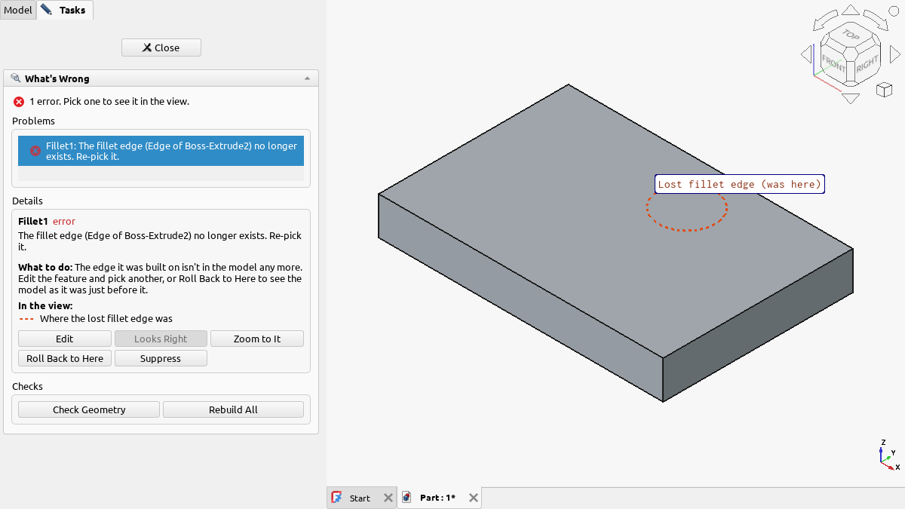

<!-- Generated by docs/build.py from docs/_data/catalog.json, docs/_authored/tools/whats-wrong.md. Do not edit this file: change its sources and run `pixi run docs`. -->

# What's Wrong

{ .tool-icon }
Lists what's wrong in the model, why, and what to do: shows each problem in the view and offers the fix.
{ .tool-lead }

What's Wrong lists every problem in the model, says why it happened and what to do, shows it in the 3D view, and offers the fix. The [health badge](../../guides/fixing-problems.md) in the status bar opens it too.

## How to use it

1. Click **What's Wrong**, or the badge in the status bar when it shows a count.
2. Click a problem. **Details** says what happened, why, and what to do; the 3D view shows where (a lost edge, in red, where it was).
3. Use the buttons: **Edit** opens the feature, **Looks Right** accepts a repaired pick, **Zoom to It**, **Roll Back to Here**, **Suppress**.
4. Click **Close**.

## Good to know

- **Check Geometry** looks for faults a rebuild doesn't report: invalid bodies, edges shorter than 0.01 mm and faces thinner than 0.005 mm.
- See [when something breaks](../../guides/fixing-problems.md).

## Where to find it

- The **Evaluate** toolbar.
- **Solid Design** → **Evaluate** → **What's Wrong**
- **Tools** → **Evaluate** → **What's Wrong**
- Command search: press <kbd>/</kbd> in the 3D view and type its name.

