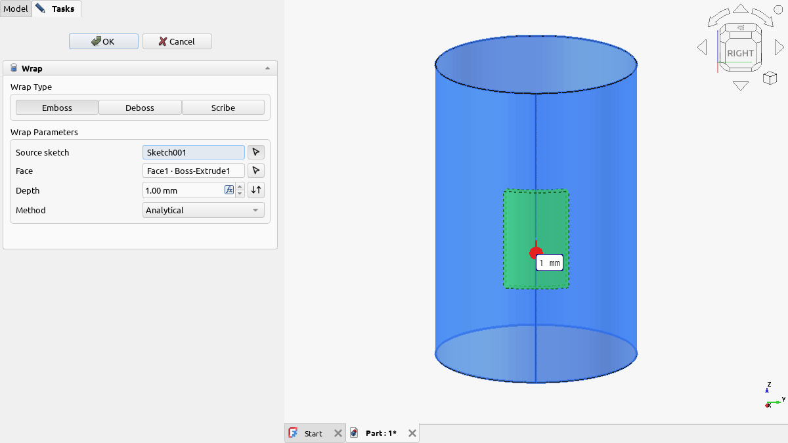

<!-- Generated by docs/build.py from docs/_data/catalog.json, docs/_authored/tools/wrap.md, docs/_data/panels.json. Do not edit this file: change its sources and run `pixi run docs`. -->

# Wrap

{ .tool-icon }
Wraps a sketch onto a cylindrical or flat face: emboss, deboss or scribe it.
{ .tool-lead }

Wrap puts a sketch onto a face: lettering round a bottle, grip lines on a handle, a logo on a curved panel.

## How to use it

1. Draw the sketch on a plane beside the face (tangent to a cylinder, or parallel to a flat face).
2. Select the sketch and the face, then click **Wrap**.
3. Choose **Emboss** (raised), **Deboss** (sunk) or **Scribe** (split lines only), and set the **Depth**.
4. Click **OK**.

## Where to find it

- The **Features** toolbar.
- **Solid Design** → **Features** → **Wrap**
- **Insert** → **Features** → **Wrap**
- Command search: press <kbd>/</kbd> in the 3D view and type its name.
- The command line: <kbd>:</kbd> then `wrap` ([below](#on-the-command-line)).

## The panel

Every control's tooltip says the same as here: hover over it in FreeCAD. **OK** (or <kbd>Enter</kbd>) makes the feature, **Cancel** (or <kbd>Esc</kbd>) leaves the model as it was.

### Wrap Type

| Control | Kind | What it does |
| :-- | :-- | :-- |
| **Emboss \\| Deboss \\| Scribe** | Buttons: *Emboss* \\| *Deboss* \\| *Scribe* |  |

### Wrap Parameters

| Control | Kind | What it does |
| :-- | :-- | :-- |
| **Source sketch** | Selection box: click a sketch | The sketch to wrap: on a plane along the cylinder's axis, or parallel to a flat face |
| **Face** | Selection box: click a face | The cylindrical or flat face to wrap onto |
| **Depth** | A length | How far it stands up or sinks in *(a flip button beside it)* |
| **Method** | One of: *Analytical*, *Spline Surface* | Analytical: rolled round a cylinder or cone without stretching (flat faces: projected). Spline Surface: projected onto any face along the sketch's normal |

## Drag handles

While the panel is open, drag the handles in the 3D view to set **Depth**, or click a handle's value and type. The same handles show when you select the feature in the tree, so you can change it without opening the panel. See [drag handles](../../guides/drag-handles.md).

## On the command line

Press <kbd>:</kbd> in the 3D view and type `wrap`, then what to set. See [the command line](../../guides/keyboard.md) for how it works.

Values typed straight after the name set, in order: **Depth**. For example `:wrap 1`.

??? note "Options it takes"

    | Option | How to type it | What it is |
    | :-- | :-- | :-- |
    | `WrapType` | a word: `emboss`, `deboss`, `scribe` | Emboss raises the sketch, Deboss sinks it, Scribe splits the face along it |
    | `Depth` | `depth=`a value | How far it stands up or sinks in |
    | `ReverseDirection` | `reversedirection` turns it on, `reversedirection=no` off | The other way |
    | `WrapMethod` | a word: `analytical`, `splinesurface` | Analytical: rolled round a cylinder or cone (flat faces: projected). Spline Surface: projected onto any face |

## Properties

??? info "All properties"

    What the feature stores, as the **Property** editor shows it (select the feature in the tree, then the **Data** tab). The panel sets these for you.

    | Property | Kind | Default | What it is |
    | :-- | :-- | :-- | :-- |
    | `WrapType` | Choice | Emboss | Emboss raises the sketch, Deboss sinks it, Scribe splits the face along it Choices: *Emboss*, *Deboss*, *Scribe*. |
    | `Sketch` | Object | – | The sketch to wrap |
    | `Items` | Picks | – | The face to wrap onto |
    | `Depth` | Length | 1 mm | How far it stands up or sinks in |
    | `ReverseDirection` | Yes/No | No | The other way |
    | `WrapMethod` | Choice | Analytical | Analytical: rolled round a cylinder or cone (flat faces: projected). Spline Surface: projected onto any face Choices: *Analytical*, *Spline Surface*. |

